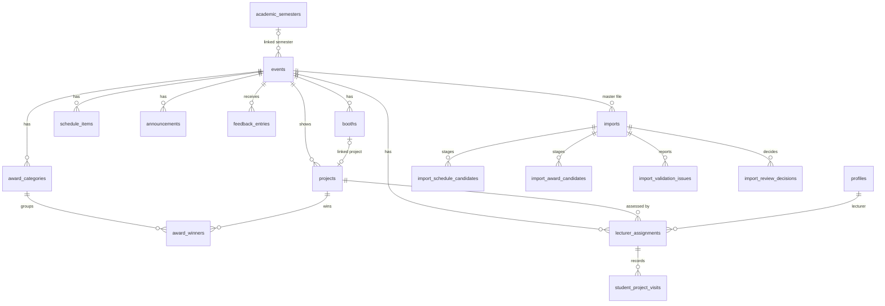
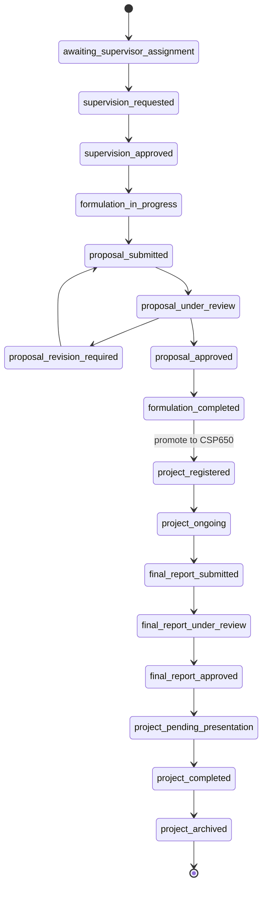

# Database reference

> Checked against the live project on 2026-10-16 (66 migrations, last `20261010000005_nomination_cv.sql`).

## Project Details
- **Project Ref**: `siedglubjcedkbrpdzgi`
- **URL**: `https://siedglubjcedkbrpdzgi.supabase.co`
- **Region**: Default (Free Tier)

## Scope

The app uses **46 tables**: **22 exhibition tables** (documented below) and
**24 FYPMS tables** (`fyp_*`, summarised at the end). The source of truth is
`supabase/migrations/`; never change the live schema outside a migration.

> **Note:** The live project also carries a small number of tables from an
> unrelated content-scheduler template (`users`, `content`, `channels`,
> `activities`, `processing_jobs`, `schedules`, `telemetry`,
> `site_settings`, `oauth_states`). They are RLS-protected and unused by
> this app.

## Data model at a glance

Exhibition side: one row in `events` per exhibition; everything public hangs
off it.

FYPMS side: one `fyp_records` row per student per course (CSP600 or CSP650)
per semester; everything else hangs off it.

```mermaid
erDiagram
    profiles ||--o{ profile_academic_roles : "holds roles"
    academic_semesters ||--o{ fyp_course_offerings : runs
    academic_courses ||--o{ fyp_course_offerings : "offered as"
    academic_semesters ||--o{ fyp_records : contains
    profiles ||--o{ fyp_records : student
    fyp_records |o--o| fyp_records : "CSP600 to CSP650"
    fyp_records ||--o{ fyp_record_assignments : "SV, co-SV, examiner"
    fyp_records ||--o{ fyp_supervision_requests : has
    fyp_records ||--o{ fyp_supervisor_change_requests : has
    fyp_records ||--o{ fyp_progress_logs : has
    fyp_records ||--o{ fyp_form_submissions : has
    fyp_form_submissions ||--o{ fyp_form_evaluations : "scored by"
    fyp_rubric_templates ||--o{ fyp_form_evaluations : uses
    fyp_records ||--o{ fyp_report_submissions : has
    fyp_records ||--o{ fyp_correction_items : has
    fyp_correction_items ||--o{ fyp_correction_confirmations : confirmed
    fyp_records ||--o{ fyp_milestones : has
    fyp_milestones ||--o{ fyp_milestone_extensions : extends
    fyp_records ||--o{ fyp_deliverables : has
    fyp_records ||--o{ fyp_lean_canvases : has
    fyp_records ||--o{ fyp_marks_summaries : graded
    fyp_records |o--o| fyp_special_evaluations : "F14 check"
    fyp_course_offerings ||--o{ fyp_presentation_sessions : schedules
    fyp_presentation_sessions ||--o{ fyp_presentation_slots : has
    fyp_records ||--o{ fyp_presentation_slots : booked
    fyp_records ||--o{ fyp_expo_publications : "published as"
    fyp_expo_publications |o--o| projects : "becomes"
    profiles ||--o{ fyp_notifications : receives
```

## Tables (22) — Exhibition

### 1. profiles
User profiles linked to Supabase Auth (`auth.users`).

| Column | Type | Constraints | Description |
|--------|------|-------------|-------------|
| `id` | `uuid` | PK, FK → auth.users(id), ON DELETE CASCADE | Auth user ID |
| `email` | `text` | UNIQUE, NOT NULL | User email |
| `display_name` | `text` | NOT NULL | Display name |
| `role` | `text` | NOT NULL, CHECK ('admin', 'lecturer') | User role |
| `is_active` | `boolean` | NOT NULL, DEFAULT true | Soft delete flag |
| `created_at` | `timestamptz` | NOT NULL, DEFAULT now() | Created timestamp |
| `updated_at` | `timestamptz` | NOT NULL, DEFAULT now() | Updated timestamp |

### 2. events
Exhibition events.

| Column | Type | Constraints | Description |
|--------|------|-------------|-------------|
| `id` | `uuid` | PK, DEFAULT gen_random_uuid() | Event UUID |
| `slug` | `text` | UNIQUE, NOT NULL | URL-friendly slug |
| `title` | `text` | NOT NULL | Event title |
| `session_label` | `text` | — | e.g. "Semester March - August 2026" |
| `start_at` | `timestamptz` | NOT NULL | Event start |
| `end_at` | `timestamptz` | NOT NULL | Event end |
| `daily_hours` | `text` | — | e.g. "9:00 AM - 5:00 PM" |
| `venue` | `text` | — | Venue name |
| `location_details` | `text` | — | Detailed location |
| `map_url` | `text` | — | Google Maps URL |
| `description` | `text` | — | Event description |
| `objectives` | `jsonb` | NOT NULL, DEFAULT '[]' | List of objectives |
| `status` | `text` | DEFAULT 'active', CHECK | 'draft'\|'upcoming'\|'active'\|'completed'\|'archived' |
| `publication_status` | `text` | DEFAULT 'published', CHECK | 'draft'\|'published'\|'archived' |
| `hero_image_url` | `text` | — | Hero image path |
| `poster_url` | `text` | — | Poster image path |
| `public_contact_email` | `text` | — | Contact email |
| `faq_items` | `jsonb` | NOT NULL, DEFAULT '[]' | FAQ Q&A list |
| `is_current` | `boolean` | one row true | The exhibition the public site shows (`set_current_event`) |
| `academic_semester_id` | `uuid` | FK → academic_semesters | Limits expo publication to that semester's CSP650 cohort |
| `updated_by` | `uuid` | FK → profiles(id) | Last editor |
| `created_at` | `timestamptz` | NOT NULL, DEFAULT now() | Created timestamp |
| `updated_at` | `timestamptz` | NOT NULL, DEFAULT now() | Updated timestamp |
| | | `chk_events_time_order` | CHECK (end_at > start_at) |

### 3. projects
FYP projects exhibited at the event.

| Column | Type | Constraints | Description |
|--------|------|-------------|-------------|
| `id` | `uuid` | PK, DEFAULT gen_random_uuid() | Project UUID |
| `event_id` | `uuid` | NOT NULL, FK → events(id) | Parent event |
| `slug` | `text` | NOT NULL, UNIQUE(event_id) | URL slug |
| `title` | `text` | NOT NULL | Project title |
| `matric_id` | `text` | — | Student matric number (public exhibition data) |
| `team_display_name` | `text` | — | Team display name |
| `programme_code` | `text` | — | e.g. "CS230" |
| `programme_name` | `text` | — | Programme name |
| `short_description` | `text` | — | Short description |
| `abstract` | `text` | — | Project abstract |
| `category` | `text` | — | Project category |
| `tech_tags` | `jsonb` | NOT NULL, DEFAULT '[]' | Technology tags |
| `student_team` | `jsonb` | NOT NULL, DEFAULT '[]' | Team members |
| `supervisor_display_name` | `text` | — | Supervisor name |
| `examiner_display_name` | `text` | — | Examiner name |
| `booth_id` | `uuid` | FK → booths(id) | Assigned booth |
| `booth_number` | `text` | — | Booth number |
| `booth_zone` | `text` | — | Booth zone |
| `presentation_day` | `text` | — | Presentation day label |
| `demo_url` | `text` | — | Demo link |
| `video_url` | `text` | — | Video link |
| `repository_url` | `text` | — | GitHub/GitLab link |
| `cover_image_url` | `text` | — | Cover image path |
| `featured` | `boolean` | NOT NULL, DEFAULT false | Featured flag |
| `industry_candidate` | `boolean` | NOT NULL, DEFAULT false | Industry candidate flag |
| `publication_status` | `text` | DEFAULT 'published', CHECK | 'draft'\|'published'\|'archived' |
| `created_at` | `timestamptz` | NOT NULL, DEFAULT now() | Created timestamp |
| `updated_at` | `timestamptz` | NOT NULL, DEFAULT now() | Updated timestamp |

### 4–22. Remaining tables

| Table | Key Columns | Description |
|-------|-------------|-------------|
| `booths` | id, event_id, booth_number, zone, status | Exhibition booths |
| `schedule_items` | id, event_id, event_date, start_at, end_at, title, access_type | Event schedule |
| `announcements` | id, event_id, title, body, is_pinned, published_at | Public announcements |
| `award_categories` | id, event_id, title, sort_order, status | Award categories |
| `award_winners` | id, event_id, category_id, project_id, title | Award winners |
| `lecturer_assignments` | id, event_id, project_id, lecturer_id, role, status | Lecturer-project assignments |
| `student_project_visits` | id, event_id, project_id, assignment_id, lecturer_id, status, visited_at | Visit tracking |
| `feedback_entries` | id, event_id, subject, message, rating, status | Visitor feedback |
| `imports` | id, event_id, file_name, status, summary | Import job tracking |
| `import_schedule_candidates` | id, import_id, row_number, start_at, end_at, title | Staging: schedule |
| `import_award_candidates` | id, import_id, row_number, award_category, project_title | Staging: awards |
| `import_validation_issues` | id, import_id, worksheet_name, row_number, severity, message | Import errors |
| `import_privacy_skips` | id, import_id, sheet_name, row_number, field_name, reason | Skipped private fields |
| `import_review_decisions` | id, import_id, candidate_id, action, reviewed_by | Review decisions |
| `settings` | key (PK), value (jsonb), updated_by | App settings |
| `audit_logs` | id, actor_uid, action, target_type, metadata_safe | Audit trail |
| `profile_academic_roles` | profile_id, role_code, programme_code, is_active | FYPMS role grants |
| `academic_semesters`, `academic_courses` | code, status / stage | Shared with FYPMS |

## Indexes

| Index | Table | Columns |
|-------|-------|---------|
| `idx_projects_event_publication` | projects | event_id, publication_status |
| `idx_projects_slug` | projects | slug |
| `idx_booths_event` | booths | event_id, status |
| `idx_schedule_event_date` | schedule_items | event_id, event_date, start_at |
| `idx_announcements_event` | announcements | event_id, is_pinned, created_at DESC |
| `idx_award_winners_event` | award_winners | event_id, publication_status |
| `idx_lecturer_assignments_lecturer` | lecturer_assignments | lecturer_id, status |
| `idx_lecturer_assignments_project` | lecturer_assignments | project_id, role |
| `idx_visits_event_project` | student_project_visits | event_id, project_id |
| `idx_visits_lecturer` | student_project_visits | lecturer_id, status |
| `idx_feedback_event` | feedback_entries | event_id, status, created_at DESC |
| `idx_imports_uploaded_by` | imports | uploaded_by, created_at DESC |
| `idx_audit_logs_event_created` | audit_logs | event_id, created_at DESC |

## Constraints

- `chk_events_time_order`: events.end_at > events.start_at
- `chk_schedule_time_order`: schedule_items.end_at > schedule_items.start_at
- FK cascade from events → booths, schedule_items, announcements, projects, etc.
- `unique (event_id, slug)` on projects
- `unique (event_id, booth_number)` on booths
- `unique (event_id, project_id, lecturer_id, role)` on lecturer_assignments
- `unique (event_id, project_id, lecturer_id, visit_role)` on student_project_visits

## FYPMS tables (24) — summary

Detailed DDL lives in `supabase/migrations/20260817000001_fypms_core_tables.sql`
(+ additive migrations). All have RLS and `updated_at` triggers.

| Table | Purpose | Key columns / relations |
|-------|---------|------------------------|
| `fyp_records` | Central FYP entity | `student_id → profiles`, `academic_semester_id`, `current_course_code` (CSP600/CSP650), `main_supervisor_id` / `co_supervisor_id` / `examiner_id`, `workflow_status` (17 states + `withdrawn`, `incomplete`), `status_before_hold`, `status_reason`, `supervisor_approved_at/by` (`20261010000004`), unique per (semester, student, course) |
| `fyp_record_assignments` | Parallel assignment rows | `fyp_record_id`, `lecturer_id`, `academic_role` (supervisor/co_supervisor/examiner), `is_active`; PU approval `pu_status` (pending/approved/rejected, set pending by trigger once the programme has a PU), `pu_decided_by`, `pu_decided_at`, `pu_comment` (`20260927000003`); nomination `cv_path`, `not_related_declared_at/by` (`20261010000005`) |
| `academic_semesters` | Semester reference | `code`, `status` (planned/active/completed/archived) |
| `academic_courses` | Course reference | `code` (CSP600/CSP650), `stage` (formulation/project) |
| `fyp_course_offerings` | Who teaches what, when | (semester, course, `lecturer_id`), `is_active`, `max_students` |
| `profile_academic_roles` | FYPMS role grants | (profile, `role_code` in 8 values incl. `programme_head` (PU), `programme_code`), `is_active` |
| `fyp_supervision_requests` | F1 requests | record FK, `preferred_supervisor_id`, `preferred_co_supervisor_id`, `project_area`, `project_title`, status pending/approved/rejected/withdrawn |
| `fyp_supervisor_change_requests` | Supervisor change via the coordinator | record FK, `requested_by`, `current_supervisor_id`, `proposed_supervisor_id`, `reason`, status pending/approved/rejected (one pending per record), decision fields (`20260927000003`) |
| `fyp_progress_logs` | F5 consultation log | record FK, one entry per meeting (`progress_date` unique per record; week derived from the semester start), status draft/submitted/validated/rejected |
| `fyp_form_submissions` | F1–F16 form payloads | record FK, `form_code` CHECK, `form_version`, `payload jsonb` |
| `fyp_form_evaluations` | Rubric scoring | submission FK + `evaluator_id` (unique pair), `criteria_scores jsonb`, server-computed `weighted_total` |
| `fyp_rubric_templates` | Versioned rubrics | `criteria jsonb`, versioned |
| `fyp_report_submissions` | Proposal/final reports (F6) | record FK, `report_type`, `version`, `file_url`, `similarity_index` (≤ 30), `plagiarism_report_url`, `endorsed_by/at`, `page_count`, `reference_count`, `academic_reference_count`, `involves_human_subjects`, `ethics_form_url` (REC) |
| `fyp_special_evaluations` | F14 qualification per record | record PK, `progress_lmc_marks`, `chapters_complete`, `presented_at_exhibition`, `final_semester_courses_passed`, `eligible`, `assessed_by/at` — written only by `assess_special_evaluation` (`20260926000010`) |
| `fyp_deliverables` | Typed checklist | record FK, `deliverable_type`, versioned |
| `fyp_lean_canvases` | F13 canvases | record FK, `canvas_version`, `is_latest` |
| `fyp_correction_items` | Corrections | record FK, auto `CORR-xxxxxxxx`, severity minor/major, status open→…→closed |
| `fyp_correction_confirmations` | Staff confirmations | correction FK, `confirmed_by` |
| `fyp_milestones` | Milestones | record FK + `milestone_code` (unique), `target_date`, status |
| `fyp_milestone_extensions` | Extension requests | milestone FK, `requested_by`, decision fields |
| `fyp_marks_summaries` | Final marks | (record, semester, course) unique, `marks jsonb`, `weighted_total`, `is_finalized` lock |
| `fyp_presentation_sessions` | Defence/expo sessions | offering FK, `session_type`, times, venue |
| `fyp_presentation_slots` | Slot bookings | session FK + record FK, `slot_number`, times, `room` |
| `fyp_expo_publications` | FYPMS → Expo bridge | record FK + `events` FK, `payload jsonb` (public-safe whitelist), `published_project_id` |
| `fyp_audit_logs` | RPC audit trail | actor, action, target, `metadata_safe jsonb`, `source='database_rpc'` |
| `fyp_notifications` | In-app bell | `recipient_id`, `kind`, `title`, `body`, `link`, `read_at`; written by `fyp_notify` |

### `fyp_records.workflow_status`

Any state can move to `withdrawn` or `incomplete` through
`set_fyp_record_standing`; `reinstate_fyp_record` restores
`status_before_hold`.

### Storage buckets (6, FYPMS)

| Bucket | Public | Limit | Types | Used for |
|---|---|---|---|---|
| `fyp-proposal-reports` | no | 20 MB | PDF, DOC, DOCX | CSP600 proposals |
| `fyp-final-reports` | no | 20 MB | PDF, DOC, DOCX | CSP650 final reports |
| `fyp-deliverables` | no | 100 MB | any | Deliverables checklist |
| `fyp-correction-evidence` | no | 20 MB | any | Evidence for corrections |
| `fyp-nomination-cvs` | no | 5 MB | PDF | Nomination CVs (`fyp_can_view_nomination_cv`) |
| `fyp-public-assets` | yes | 20 MB | PNG, JPEG, WebP, PDF | Images published to the exhibition |

Private buckets are path-scoped via `can_read_fyp_storage_path` /
`can_write_fyp_storage_path`. Path convention:
`{semester_code}/{fyp_record_id}/{resource_type}/{version}/{file_name}`.

> The `avatars` and `media` buckets, like the template tables above, belong
> to the unrelated content-scheduler template and are unused.
