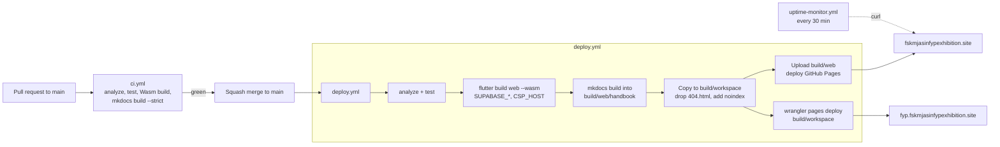

# Deployment

## Overview

One **Flutter Web** build is deployed twice: to **GitHub Pages** (the
exhibition) and to **Cloudflare Pages** (the FYP Workspace). The user
handbook is built with MkDocs into `/handbook/` of that same build. The
backend is **Supabase** (Postgres with Auth, Storage, Realtime and RLS).

- **Exhibition**: https://fskmjasinfypexhibition.site (GitHub Pages)
- **FYP Workspace**: https://fyp.fskmjasinfypexhibition.site (Cloudflare Pages project `fyp-workspace`)
- **Handbook**: `/handbook/` on both hosts
- **Admin CMS**: https://fskmjasinfypexhibition.site/admin — `admin.fskmjasinfypexhibition.site` is a Cloudflare redirect (302) to it
- **Backend**: Supabase project `siedglubjcedkbrpdzgi`

## CI/CD Pipeline

### Pipeline at a glance



### GitHub Actions Workflow

File: `.github/workflows/deploy.yml`

The workflow triggers on every push to `main` (permissions `contents: read`,
`pages: write`, `id-token: write`; concurrency group `pages` cancels an
in-progress deploy). Third-party actions are pinned to commit SHAs. It
performs:

| # | Step | What it does |
|---|------|--------------|
| 1 | **Checkout** | `actions/checkout` (v4) |
| 2 | **Setup Flutter** | `subosito/flutter-action` (v2), stable channel pinned to Flutter `3.44.7` |
| 3 | **`flutter pub get`** | Install dependencies |
| 4 | **`flutter analyze`** | Gate — strict, any issue fails the deploy |
| 5 | **`flutter test`** | Gate — the full suite must pass |
| 6 | **Build Web** | `flutter build web --release --wasm --base-href "/"` with `--dart-define` credentials from secrets; copies `index.html` → `404.html` (SPA fallback for deep links); stamps the first 12 chars of the commit SHA into `{{BUILD_VERSION}}` in `sw.js` and `flutter_bootstrap.js` so each release gets a fresh service-worker cache |
| 7 | **Build Handbook** | `pip install -r docs/requirements.txt`, then `mkdocs build --strict -d build/web/handbook` (user guides + developer overview only) |
| 8 | **Prepare Workspace Copy** | `build/web` → `build/workspace`, removes `404.html` (Cloudflare then serves `index.html` for deep links) and adds a `_headers` noindex rule |
| 9 | **Upload Artifacts** | `actions/upload-pages-artifact` (v3) with `build/web` |
| 10 | **Deploy to GitHub Pages** | `actions/deploy-pages` (v4) into the `github-pages` environment |
| 11 | **Deploy FYP Workspace** | `cloudflare/wrangler-action` → `pages deploy build/workspace --project-name=fyp-workspace`; skipped when the Cloudflare secrets are absent |

Pull requests to `main` run the same analyze + test gates and a Wasm
smoke build (no credentials, no deploy) in `.github/workflows/ci.yml`, so
web-only breakage is caught before merge.

### Required GitHub Secrets

| Secret | Description |
|--------|-------------|
| `SUPABASE_URL` | The Supabase project URL: `https://siedglubjcedkbrpdzgi.supabase.co` |
| `SUPABASE_ANON_KEY` | The Supabase anon/public key |

To add secrets: GitHub Repo → Settings → Secrets and variables → Actions → New repository secret

### Build Command

```bash
flutter build web --release --wasm \
  --dart-define=SUPABASE_URL='https://siedglubjcedkbrpdzgi.supabase.co' \
  --dart-define=SUPABASE_ANON_KEY='<your-anon-key>' \
  --base-href '/'
```

## Environment Configuration

### Production (CI/CD)
Credentials are injected at build time via GitHub Actions secrets.
No `.env` file is needed in CI.

### Local Development
Create a local `.env` file (gitignored):
```env
SUPABASE_URL=https://siedglubjcedkbrpdzgi.supabase.co
SUPABASE_ANON_KEY=<your-anon-key-from-supabase-studio>
```

Run locally:
```bash
flutter run -d chrome \
  --dart-define=SUPABASE_URL='https://siedglubjcedkbrpdzgi.supabase.co' \
  --dart-define=SUPABASE_ANON_KEY='<your-anon-key>'
```

## Supabase Configuration

### Project Settings
- **Project**: `siedglubjcedkbrpdzgi` (My Project)
- **Region**: Default (Free Tier)
- **Auth**: Email/password provider enabled
- **Database**: PostgreSQL with all migrations applied

### Supabase Auth settings

The password-reset flow (G-32) emails a recovery link that returns to
`<current origin>/reset-password` (`passwordResetRedirectUrl()` in
`lib/features/admin_auth/password_reset.dart`). Supabase only redirects to
allow-listed URLs, so under **Authentication → URL Configuration →
Redirect URLs** add:

| Redirect URL | Used by |
|---|---|
| `https://fskmjasinfypexhibition.site/reset-password` | "Forgot password?" on `/sign-in` (the shared sign-in page) |
| `https://admin.fskmjasinfypexhibition.site/reset-password` | Admin domain (kept in case the link is built from that origin) |

Without these entries the reset email falls back to the Site URL and the
user never reaches the "set a new password" page.

**Two-step verification (F8).** Users turn on an authenticator app (TOTP)
under My Account; TOTP MFA is enabled by default on Supabase projects
(Authentication → Multi-Factor). Once an account has a verified factor,
`is_admin()` / `is_fyp_coordinator()` only return true for an `aal2`
session (`20260927000014`). There is no per-account lockout: brute-force
protection is Supabase Auth's sign-in rate limit (Authentication → Rate
Limits).

**Email.** Supabase's built-in SMTP sends only a few auth emails per hour
(password recovery), so FYPMS notifications are in-app (`fyp_notifications`,
the bell). Sending them by email would need a custom SMTP provider
(Authentication → Emails → SMTP Settings) plus a sender (e.g. an Edge
Function on a schedule); not set up.

### Edge Functions

| Function | JWT | Purpose |
|---|---|---|
| `enroll-students` | verified | Coordinator bulk enrolment (U3): checks `is_fyp_coordinator` with the caller's token, creates missing Auth users with the service role (`email_confirm: true`, no invite), then calls `enroll_student` as the caller |

Deploy with `supabase functions deploy enroll-students` (or the Supabase
MCP `deploy_edge_function`). It uses the built-in `SUPABASE_URL`,
`SUPABASE_ANON_KEY` and `SUPABASE_SERVICE_ROLE_KEY` secrets — nothing to
configure. New students sign in through *Forgot password?*.

### Current exhibition

The app reads the exhibition marked `events.is_current` at start-up
(`loadCurrentEvent()`, 4 s timeout, falling back to `fskm-fyp-2026` and
the bundled offline data). Admins switch it from Event → Exhibitions; no
redeploy is needed.

### Migrations

Migrations live in `supabase/migrations/` (timestamp-prefixed, applied in
order):

```
20260814000001..04  Expo Hub: schema, RLS, RPCs, seed
20260817000001..07  FYPMS: core tables, helpers, RLS, RPCs, storage, seed
20260818/19*        FYPMS: student slice, workflow RPCs, seeds, realtime
20260820000001/02   FYPMS demo seed + realtime publication
20260821*           (live-only populate_projects bulk-import series)
20260822*           Defect fixes (DEF-1..7), auth policies, co-supervisor seed
20260901*           Security hardening (storage path-scoping, RPC gates,
                    exec_sql_batch removal, F14-F16 flag, evidence RPC)
20260902*           Staff directory + roles
20260925*           Audit 2 hardening, published demo accounts disabled
20260926000001..09  Textbook alignment R1-R7/R10 (rubrics, evaluators,
                    course marks, F1, F6, F5, deliverables), workflow
                    fixes, DB hardening
20260926000010..12  R8 F14 special evaluation, R9 exhibition F10, G-25
                    extensions/sessions
20260927000001      G-06 import Replace + staged checks
20260927000002/03   R11 report minimums + REC ethics, supervisor change +
                    PU approval
20260927000004..07  Multi-semester (S1-S3), current event + archive (S6),
                    users / roles / enrolment (U2, U3), rubric versions +
                    session edits (U4, U5)
20260927000008..14  Notifications (F1), account self-service (F2),
                    withdrawn / incomplete + reopen marks (F3, F4),
                    project / booth import (F5), cohort report (F6),
                    approved nominations (F7), MFA for admin /
                    coordinator (F8)
```

To apply migrations:
```bash
supabase db push
```

> The live project also contains a historical `populate_projects` /
> `exec_sql` migration series applied during the initial bulk import; it has
> been cleaned up (`exec_sql`/`exec_sql_batch` dropped) and is not part of
> the repo's migration set.

### TypeScript Types

Generated types are in `supabase/types.ts`:
```bash
npx supabase gen types typescript --project-id siedglubjcedkbrpdzgi
```

## Domain Configuration

### Custom Domain
- **Public**: `fskmjasinfypexhibition.site` (managed via GitHub Pages, CNAME)
- **Admin**: `admin.fskmjasinfypexhibition.site` — Cloudflare **Redirect Rule** (Hostname equals `admin.fskmjasinfypexhibition.site` → 302 to `https://fskmjasinfypexhibition.site/admin`). It is **not** a GitHub Pages site: a repo's Pages site serves one custom domain, and this repo's is the apex. (Until 2026-09 it pointed at a separate, stale 6 Aug build that never received deploys.)

### Moving the FYP Workspace to `fyp.`

The exhibition stays on `fskmjasinfypexhibition.site` (GitHub Pages); CSP600 / CSP650 (`/fypms`) moves to `fyp.fskmjasinfypexhibition.site` (Cloudflare Pages). Both serve the **same build**: `deploy.yml` builds once and, when the Cloudflare secrets exist, also uploads a copy (no `404.html`, so Cloudflare serves it as a single-page app; `X-Robots-Tag: noindex`) to the Cloudflare Pages project `fyp-workspace`. The app tells the hosts apart at runtime (`lib/app/site_hosts.dart`, `_siteHostGuard` in `lib/app/router_guards.dart`), switched on by the repo variable `CSP_HOST`.

| Step | Who | Action | Gate before proceeding |
|---|---|---|---|
| 1 | You | Cloudflare → Workers & Pages → Create → Pages → **Direct Upload**: project name `fyp-workspace` (upload any placeholder file once) | Project exists |
| 2 | You | Cloudflare → My Profile → API Tokens → Create token with **Account → Cloudflare Pages → Edit**. Note the Account ID (Workers & Pages overview) | Token and Account ID in hand |
| 3 | You | GitHub repo → Settings → Secrets and variables → Actions → **Secrets**: `CLOUDFLARE_API_TOKEN`, `CLOUDFLARE_ACCOUNT_ID` | Next deploy run shows "Deploy FYP Workspace to Cloudflare Pages" succeeded (re-run the latest Deploy workflow, or merge any PR) |
| 4 | You | Cloudflare → `fyp-workspace` → Custom domains → add `fyp.fskmjasinfypexhibition.site` (the zone is on Cloudflare, so the DNS record is created for you) | `https://fyp.fskmjasinfypexhibition.site/sign-in` loads |
| 5 | You | Supabase → Authentication → URL Configuration → Redirect URLs: add `https://fyp.fskmjasinfypexhibition.site/reset-password` | Saved |
| 6 | You | GitHub → Settings → Secrets and variables → Actions → **Variables**: `CSP_HOST` = `fyp.fskmjasinfypexhibition.site`, then re-run the latest Deploy workflow | Run succeeds |
| 7 | Both | Smoke test: `/fypms` on the main site moves to `fyp.`; `/booths` on `fyp.` moves back; `/` on `fyp.` opens sign-in; a student signs in on `fyp.` and lands on `/fypms/student`; "Forgot password?" on `fyp.` lands on `fyp./reset-password` | All pass |

Until step 6 both hosts behave like the main site, so nothing breaks while the new site is being set up. To roll back, clear `CSP_HOST` and re-run the deploy: the main site serves `/fypms` again.

Sign-in is stored per site, so a lecturer signs in once on the main site (booth visits, admin) and once on `fyp.` (CSP). Sharing one session across both needs cookie-based auth storage on `.fskmjasinfypexhibition.site` (backlog W4).

### SPA Handling
- `404.html` is copied from `index.html` to handle client-side routing
- `go_router` handles all route matching client-side

## Rollback Procedure

### Rolling Back a Deployment
1. Revert the git commit / PR
2. GitHub Actions will rebuild and redeploy automatically
3. Or manually deploy a previous build:
   ```bash
   git checkout <previous-commit>
   flutter build web --release --wasm
   # Or re-run the "Deploy Flutter Web to GitHub Pages" workflow for that commit
   ```

### Rolling Back the Database

The free plan keeps no backups, so `.github/workflows/db-backup.yml` takes
one every night at 02:00 Malaysia time: the `public` schema with its data,
plus the data of `auth` (accounts) and `storage` (file metadata, not the
files). It is encrypted with `BACKUP_PASSPHRASE` and kept as a workflow
artifact for 30 days.

| Secret | Value |
|---|---|
| `SUPABASE_DB_URL` | Supabase → Project Settings → Database → Connection string → **Session pooler** URI, with the database password |
| `BACKUP_PASSPHRASE` | A long random string. Keep a copy outside GitHub: without it the backups can't be opened |

Until both secrets exist the workflow skips with a warning instead of
failing. Run it once by hand (Actions → Database Backup → Run workflow) to
check it.

**Restore**

1. Download the artifact from the run (Actions → Database Backup → the run
   → Artifacts) and unzip it.
2. Decrypt and unpack:

    ```bash
    gpg --decrypt backup-YYYYMMDD-HHMM.tar.gz.gpg > backup.tar.gz
    ```

    ```bash
    tar -xzf backup.tar.gz
    ```

3. Into an empty project (or after dropping the damaged `public` schema),
   load the schema and data, then the accounts:

    ```bash
    psql "$SUPABASE_DB_URL" -f public.sql
    ```

    ```bash
    psql "$SUPABASE_DB_URL" -f auth-data.sql
    ```

4. Uploaded files (reports, CVs, deliverables) are not in the dump; only
   their `storage.objects` rows are (`storage-data.sql`).
5. Smaller fixes: re-run migrations from a specific point, see
   [history/migration-report.md](history/migration-report.md).

## Health Checks

### Post-Deployment
- [ ] Public site loads: https://fskmjasinfypexhibition.site
- [ ] Sign-in works: https://fskmjasinfypexhibition.site/sign-in (and `/admin/sign-in` forwards to it) (and https://admin.fskmjasinfypexhibition.site redirects there)
- [ ] Supabase Realtime is connected (check browser dev tools → Network → WebSocket)
- [ ] Project data renders on the public site
- [ ] Schedule data renders

### Monitoring
- Supabase Studio: https://supabase.com/project/siedglubjcedkbrpdzgi
- Check for errors in the browser console
- Monitor Supabase log explorer for slow queries or auth errors

## Paused Project Handling

Free-tier Supabase projects are paused after 7 days of inactivity. When paused:
- The Flutter app does not crash: public datasets report `offline` (or
  `failed` if nothing is bundled for them) and show an offline banner or an
  error with Retry
- Public pages still render from the bundled `assets/data/offline_fallback.json`
  (387 projects, 221 booths, 8 schedule items)
- Admin/lecturer features are unavailable until the project is resumed

To resume: Supabase Studio → Project Settings → Resume project
