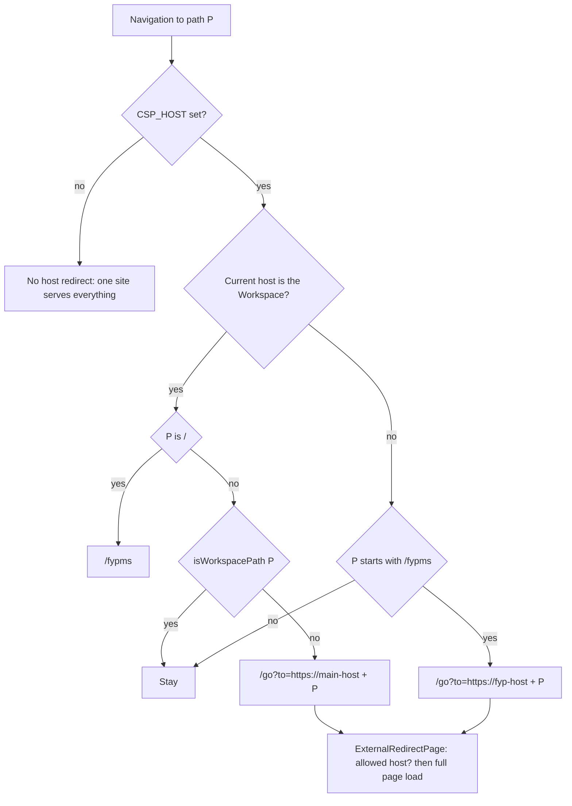
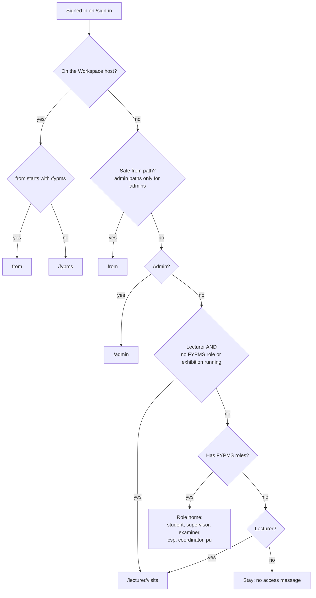
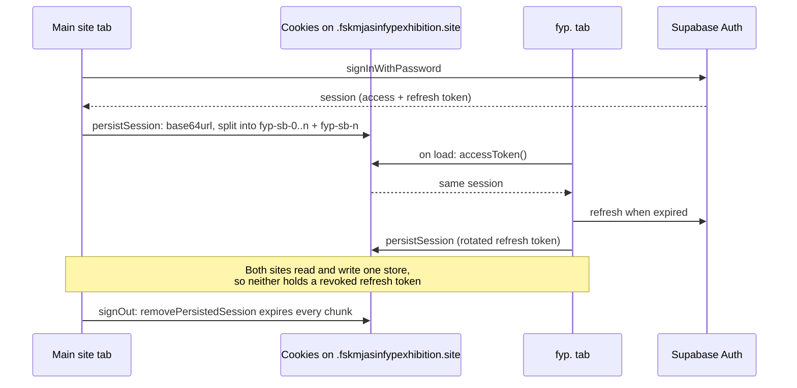

# Hosts, routing and sign-in

One Flutter build serves three hostnames. The app works out which site it is
at runtime, routes people to the right one, and shares the sign-in between
them.

| Host | Served by | Shows |
|---|---|---|
| `fskmjasinfypexhibition.site` | GitHub Pages (`build/web`) | Exhibition, Past Projects Guide, lecturer My Visits, admin CMS, `/handbook/` |
| `fyp.fskmjasinfypexhibition.site` | Cloudflare Pages project `fyp-workspace` (`build/workspace`, noindex) | FYP Workspace (`/fypms/*`) for CSP600 / CSP650 |
| `admin.fskmjasinfypexhibition.site` | Cloudflare redirect rule | Shortcut: `/` → sign-in or `/admin` |

## Which site am I? (`lib/app/site_hosts.dart`)

| Name | Meaning |
|---|---|
| `kMainHost` | `fskmjasinfypexhibition.site` |
| `cspHostProvider` | The Workspace host from `--dart-define=CSP_HOST` (repo variable `vars.CSP_HOST`). Empty means "Workspace lives under `/fypms` on the main site". |
| `currentHostProvider` | `Uri.base.host`; overridden in tests |
| `isWorkspacePath(path)` | `/fypms*`, `/sign-in`, `/reset-password`, `/go` |
| `cspUrl` / `mainSiteUrl` | Absolute URL on the other host |
| `externalRedirect(url)` | `/go?to=<url>`; `ExternalRedirectPage` follows it only for https on `allowedRedirectHosts` (no open redirect) |
| `openCspWorkspace` / `openExhibitionSite` | Buttons that jump between sites |

**Rollback:** delete the `CSP_HOST` repo variable and re-run the deploy. The
main site serves `/fypms` again; the redirects switch off.

## Redirects between hosts (`_siteHostGuard`)

`go_router` can't redirect across origins, so `/go` does it with
`launchUrl(..., webOnlyWindowName: '_self')`.

## Route guards (`resolveRouterRedirect`, `lib/app/router_guards.dart`)

Order of checks on every navigation:

1. `/admin/sign-in` → `/sign-in` (keeps the query); `/expo` → `/`.
2. `_siteHostGuard` (above).
3. `/fypms*` → `_fypmsAuthGuard`: signed out → `/sign-in?from=…`; no FYPMS
   role → "No FYPMS Access"; a workspace the roles don't allow → the user's
   home workspace.
4. `admin.` host root → `_adminDomainRootGuard`.
5. `/lecturer/visits*` → lecturer or admin only, else `/`.
6. `/admin*` → `_adminPathGuard`: signed out → `/sign-in?from=…`; signed in
   but not admin → `/sign-in?from=…&reason=not-admin`.
7. Signed in on `/sign-in` → `_postLoginRedirect` (below), except with
   `reason=not-admin` while the account still isn't an admin: the page stays
   and shows the notice with **Switch Account**.

## After sign-in (`_postLoginRedirect`)

"Exhibition running" means from the day before the current event starts to
the day after it ends. `safeReturnPath` rejects anything that isn't a
same-origin path.

## Two kinds of role

| Kind | Where | Values | Controls |
|---|---|---|---|
| Account role | `profiles.role` | `admin`, `lecturer` (students have a profile too) | Admin CMS, lecturer My Visits |
| Academic roles | `profile_academic_roles.role_code` (+ `programme_code`) | `student`, `supervisor`, `co_supervisor`, `examiner`, `csp600_lecturer`, `csp650_lecturer`, `programme_head`, `fyp_coordinator`, `admin` | FYP Workspace menus and RPC gates |

Granted in **Coordinator → People → Users & Roles**
(`set_user_academic_role`, `set_profile_account_role`).

## MFA

TOTP via Supabase Auth (`lib/features/admin_auth/mfa.dart`). `MfaGate` wraps
the admin and Workspace shells. Once an account has a verified factor,
`mfa_satisfied()` makes `is_admin()` / `is_fyp_coordinator()` require an
`aal2` session, so the powers need the second step too.

## Shared sign-in (`lib/core/supabase/shared_session_storage.dart`)

| Detail | Value |
|---|---|
| Cookie attributes | `Domain=fskmjasinfypexhibition.site; Path=/; Max-Age=30 days; Secure; SameSite=Lax` |
| Chunk size | 3000 characters (cookie limit is 4 KB) |
| When used | Only when the host is the main domain or a subdomain (`sharedSessionStorageFor`); localhost and previews keep Supabase's default localStorage |
| Migration | `initialize()` copies an old `sb-<ref>-auth-token` localStorage session into the cookies once, then deletes it |
| Already-open tab on the other site | Sees the change on its next page load |
| Debugging | DevTools → Application → Cookies → look for `fyp-sb-*` |

## Password reset

`resetPasswordForEmail` with `redirectTo: <current origin>/reset-password`
(`lib/features/admin_auth/password_reset.dart`). Both origins must be in
Supabase **Auth → URL Configuration → Redirect URLs**. `/reset-password`
lives outside `/admin` so the short-lived recovery session isn't bounced.

## Tests

| Test | Covers |
|---|---|
| `test/app/site_hosts_routing_test.dart` | Host redirects, `/expo`, post-login landing, not-admin notice |
| `test/core/shared_session_storage_test.dart` | Chunking, sign-out, migration, garbled cookies, host check |
| `test/features/fypms/fypms_route_guards_test.dart` | Workspace role gates |
