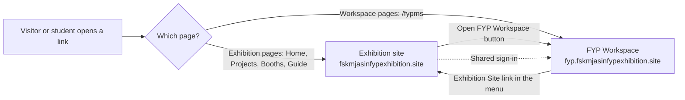
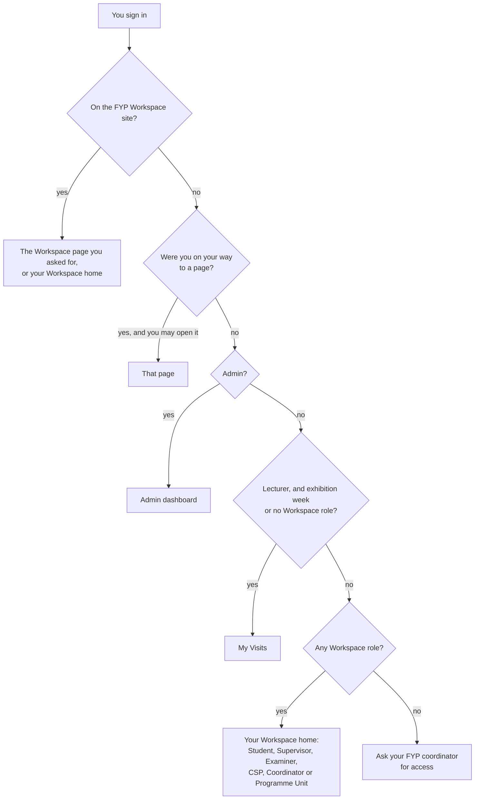
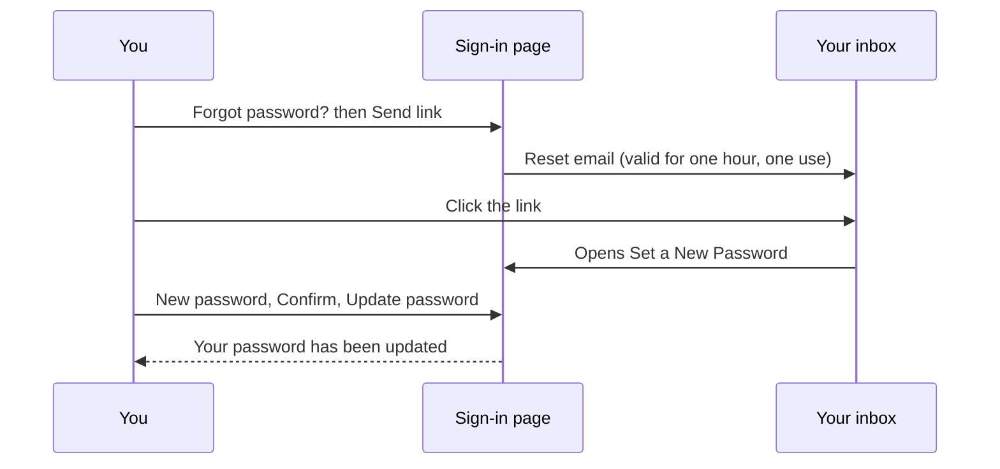
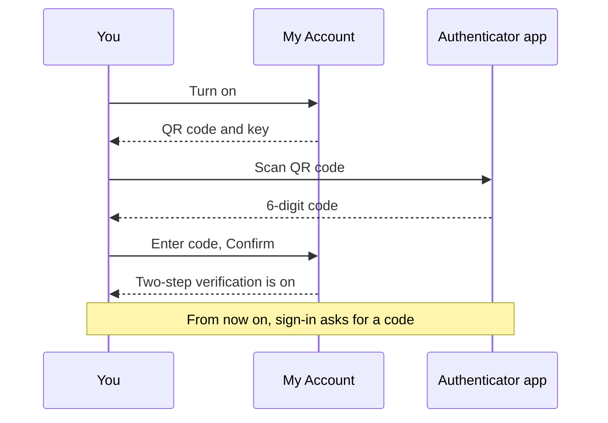

# Accounts and signing in

## Who this is for

Anyone with an FYP Expo Hub account: CSP600 and CSP650 students, lecturers
(supervisors, examiners, course lecturers, programme heads), FYP
coordinators and exhibition admins. It covers how to sign in, where you land
afterwards, how to reset a forgotten password, and how to protect your
account with two-step verification.

Visitors do not need an account. The whole exhibition is open without
signing in, see the [Visitor guide](visitor.md).

!!! note "One account, two sites"
    The same email and password work on both sites. Sign in once and you are
    signed in on the other site too.

## The two sites {#two-sites}

| Site | Address | What it is for |
|---|---|---|
| Exhibition | `fskmjasinfypexhibition.site` | The public exhibition, the Past Projects Guide, lecturers' **My Visits**, the exhibition admin pages and this handbook |
| FYP Workspace | `fyp.fskmjasinfypexhibition.site` | CSP600 and CSP650 work: supervision, forms, reports, milestones, presentations and marks |

The app moves you between the two sites by itself. If you open a Workspace
page on the exhibition site, you are sent to the Workspace site, and the
other way round. For a moment you may see a page that says
**Opening fyp.fskmjasinfypexhibition.site…** with an **Open It Now** button.
That is the hop between sites; it normally finishes by itself.

Both sites keep your sign-in in a shared place, so signing in or out on one
also applies to the other. A tab that is already open on the other site
notices the change the next time it loads a page.

## 1. Sign in {#sign-in}

[Open Sign In :octicons-link-external-16:](https://fskmjasinfypexhibition.site/sign-in){ .md-button target=_blank rel=noopener }

First open the sign-in page:

=== "Desktop"

    On the exhibition site, click **Sign In** at the top right, or open
    `/sign-in` directly.

=== "Phone"

    On the exhibition site, tap **Menu** (the last tab at the bottom), then
    **Sign In**. You can also open `/sign-in` directly.

On the FYP Workspace site you are sent to the sign-in page automatically
when you are not signed in. Then:

1. Type your university email in **Official Email**.
2. Type your **Password**. Use the eye button (**Show password**) to check
   what you typed.
3. Click **Sign In**.

The page says *Students and lecturers use one account.* Students,
lecturers, coordinators and admins all use this same page.

If you opened a link to a particular page before signing in, you are taken
back to that page after signing in. Otherwise you land on your own home
page, shown below.

### Where you land after signing in {#landing}

| Your account | Where you land |
|---|---|
| Exhibition admin | Admin dashboard (`/admin`) |
| Lecturer during exhibition week, or a lecturer with no Workspace role | **My Visits** (`/lecturer/visits`) |
| Student | **Student Dashboard** (`/fypms/student`) |
| Supervisor or co-supervisor | **Supervisor Dashboard** (`/fypms/supervisor`) |
| Examiner | **Examiner Dashboard** (`/fypms/examiner`) |
| CSP600 or CSP650 lecturer | CSP dashboard (`/fypms/csp`) |
| FYP coordinator | **Coordinator Dashboard** (`/fypms/coordinator`) |
| Programme head | **Nominations** (`/fypms/pu`) |

If you hold more than one role, the first one in the table (from Student
downwards) is your home page, and the Workspace menu shows a section for
each of your roles. "Exhibition week" means from the day before the
exhibition starts to the day after it ends.

!!! tip "Already signed in?"
    Clicking **Sign In** again while you are signed in simply takes you to
    your home page. You do not need to type your password again.

### Sign out {#sign-out}

=== "Desktop"

    In the FYP Workspace, click the **Sign Out** button (the arrow icon) at
    the top right.

=== "Phone"

    In the FYP Workspace, tap the **Sign Out** button (the arrow icon) at the
    top right. On a narrow phone it is not there: tap the three-line icon at
    the top left to open the menu, and tap **Sign Out** at the bottom.

Signing out on one site signs you out on the other too.

## 2. Reset a forgotten password {#reset-password}

1. On the sign-in page, click **Forgot password?**.
2. In the **Reset password** box, check the **Email** (it copies what you
   typed on the sign-in page) and click **Send link**.
3. The box says that if an account exists for that email, a reset link is on
   its way. The link works once and expires after an hour.
4. Open the email and click the link. It opens **Set a New Password**
   (`/reset-password`) on the same site where you asked for it.
5. Type a **New password** and type it again in **Confirm new password**.
   It needs at least 8 characters, with both letters and numbers.
6. Click **Update password**. When you see *Your password has been
   updated.*, click **Continue** and sign in with the new password.

!!! warning "Link expired?"
    If the page says *This reset link is invalid or has expired*, click
    **Back to sign in** and ask for a new link. Each link works only once.

## 3. My Account: your name and password {#my-account}

**My Account** is in the top bar of the FYP Workspace and the admin pages.
On a computer it shows your email address; on a phone it is the round
person icon (**My account**).

### Change your display name

1. Click your email (or the person icon) to open **My Account**.
2. Edit **Display name** (2 to 80 characters).
3. Click **Save name**. You see *Name saved.*

### Change your password

1. Open **My Account**.
2. Under **Change password**, fill in **Current password**, **New
   password** and **Confirm new password**.
3. Click **Change password**. You see *Password changed.*

The new password needs at least 8 characters, with letters and numbers. If
you see *Your current password is not correct.*, check the first box.

## 4. Two-step verification (MFA) {#mfa}

Two-step verification adds a 6-digit code from an authenticator app on your
phone (for example Google Authenticator or Microsoft Authenticator) to your
password. Someone who learns your password still cannot get in without your
phone.

| Who | Is it required? |
|---|---|
| Students and lecturers | Optional, but a good idea |
| FYP coordinators and exhibition admins | Recommended. Once it is on for your account, your coordinator and admin powers only work after you enter the code |

When it is on, the FYP Workspace and the admin pages show
**Two-step verification** after you sign in (and after a page reload). Enter
the **6-digit code** from your app and click **Verify**. The exhibition
pages themselves never ask for the code.

### Tutorial: set up two-step verification {#mfa-setup}

You need your phone with an authenticator app installed, and about five
minutes.

Tick steps as you go; your progress stays in this browser.

- [ ] Sign in and open the FYP Workspace.
- [ ] Click your email at the top right (on a phone, the person icon) to open
  **My Account**.
- [ ] Scroll to **Two-step verification**. It says **Off**. Click **Turn on**.
- [ ] A QR code appears with the text *Scan this with your authenticator app,
  then enter the code it shows.*
- [ ] In your authenticator app, add a new account and scan the QR code. If you
  cannot scan it, choose manual entry in the app and type the key shown
  under **Or enter this key:**.
- [ ] The app now shows **FYP Expo Hub** with a 6-digit code that changes every
  30 seconds.
- [ ] Type the current code in **6-digit code** and click **Confirm**.
- [ ] You see *Two-step verification is on.* The section now says
  **On — sign-in asks for a code from your authenticator app.**
- [ ] Test it: click **Close**, sign out, and sign in again. After your
  password, the **Two-step verification** screen asks for a code. Enter it
  and click **Verify**.

!!! warning "Keep your phone safe"
    If you lose the phone with your authenticator app, you cannot finish
    signing in. Ask your FYP coordinator or the exhibition admin for help.

To turn it off, open **My Account**, click **Turn off** under **Two-step
verification**, and confirm with **Turn Off**. Coordinator and admin powers
may stop working until you turn it on again.

## 5. Messages you may see

### "No FYPMS Access" {#no-access}

You signed in and opened the FYP Workspace, but it shows **No FYPMS
Access**: *Your account is not assigned an active FYPMS role yet. Please
contact your coordinator.*

This means your account exists but nobody has given it a Workspace role
(student, supervisor, examiner and so on) yet. Only the FYP coordinator can
add roles. Click **Sign Out**, and ask your coordinator to add you. Once they
have, sign in again.

### "This account has no access yet"

If you sign in on the exhibition site with an account that has no role at
all, the sign-in page stays open and says *You're signed in as …, but this
account has no access yet. Ask the FYP coordinator to give you a role.*
Click **Switch Account** to sign in with a different account, or ask your
coordinator to add a role. Once they have, sign in again and you go straight
to your page.

### "You're signed in as …, which isn't an admin account" {#not-admin}

You opened an exhibition admin page (`/admin…`) while signed in with an
account that is not an admin, for example your student account. The sign-in
page shows:

> You're signed in as *your email*, which isn't an admin account. Sign in
> with an admin account to open this page.

- If you meant to open the admin pages, click **Switch Account**. This signs
  you out; then sign in with the admin account.
- If you did not mean to, just go back. Your own account still works as
  before.

## Troubleshooting

| Problem | What to do |
|---|---|
| *Invalid email or password. Please try again.* | Check the email is your official university email and the password is typed correctly (use **Show password**). If you still cannot get in, use **Forgot password?** |
| *Please confirm your email address before signing in.* | Open the confirmation email from when your account was created and click its link, or ask your coordinator to resend it. |
| *Too many requests. Please try again in a few minutes.* | You asked for several reset links quickly. Wait a few minutes and try once. |
| The reset email does not arrive | Check your spam or junk folder. The message is the same whether or not the email has an account, so make sure you used the address your coordinator registered. |
| *This reset link is invalid or has expired* | The link was used already or is over an hour old. Ask for a new one. |
| *That code did not work. Check the time on your phone and try again.* | Your phone's clock may be wrong. Turn on automatic date and time on your phone, then try the newest code. |
| *This account has no access yet* after signing in | Your account has no role. Ask your FYP coordinator to add one, or click **Switch Account**. |
| **No FYPMS Access** | Your account has no Workspace role yet. Ask your FYP coordinator to add one. |
| I am signed in on one site but not the other | Reload the page on the other site. A tab that was already open only sees the change after it loads a new page. |
| A page says *This link does not lead to one of our sites.* | The link was changed or is not ours. Go to the address you know (see the table at the top) instead. |

## See also

- [Visitor guide](visitor.md)
- [Student guide](student.md)
- [Lecturer guide](lecturer.md)
- [Coordinator guide](coordinator.md)
- [Exhibition admin guide](exhibition-admin.md)
- [Handbook home](../index.md)
