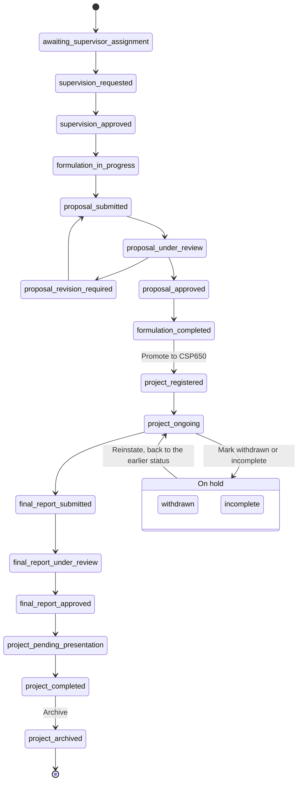
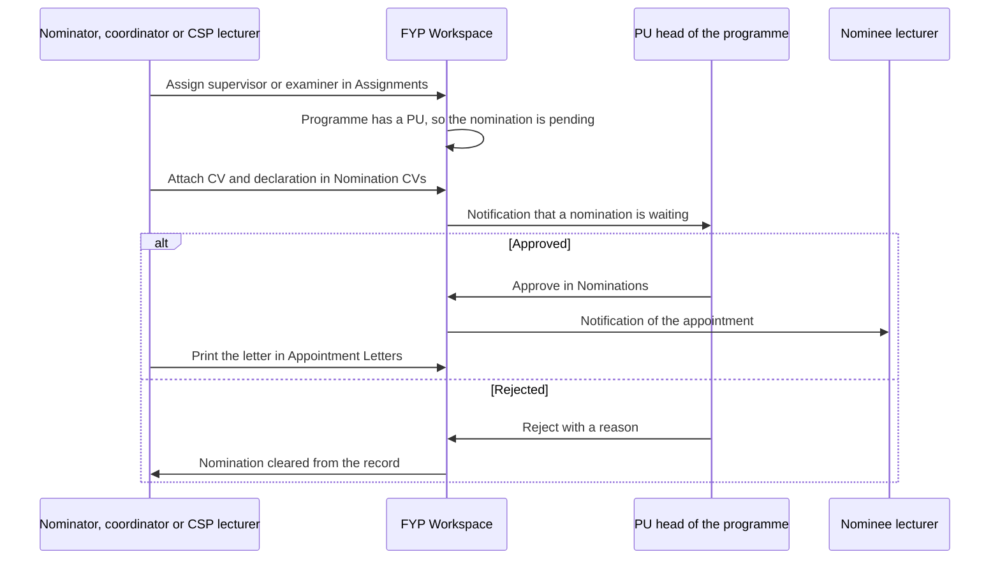
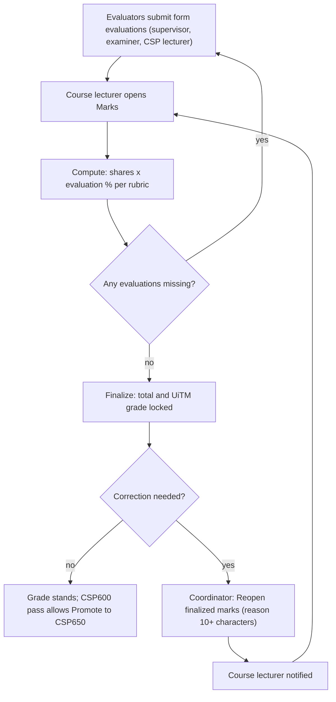
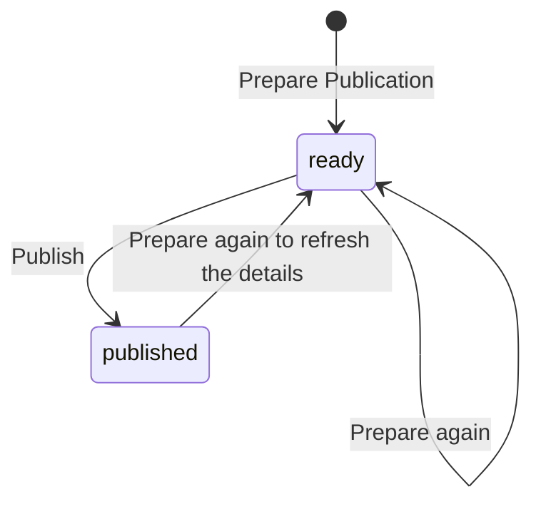
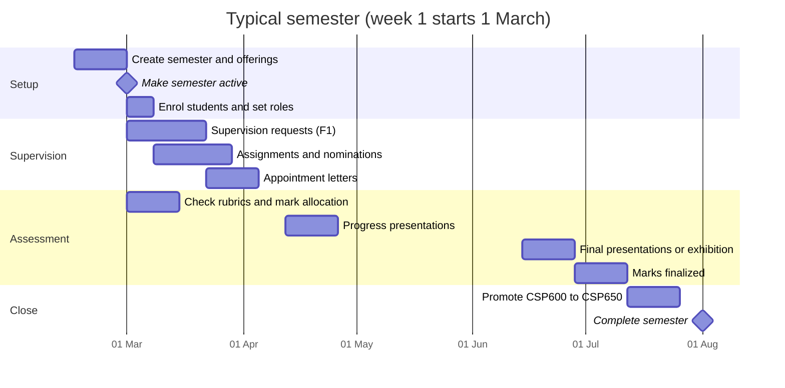

# Coordinator guide

This guide is for the **FYP coordinator**: the person who runs CSP600 and
CSP650 for the faculty. It covers setting up a semester, managing people and
roles, assessment setup, record corrections, reports and sending CSP650
projects to the exhibition.

Administrators see everything here too, plus a few admin-only controls
(marked **Admin only** below). For signing in, two-step verification and your
own account, see [Accounts and sign-in](accounts.md).

!!! info "Where to find it"
    Sign in to the FYP Workspace and open the **Coordinator** section of the
    menu. The coordinator pages live under `/fypms/coordinator`, for example
    `https://fyp.fskmjasinfypexhibition.site/fypms/coordinator`.

!!! warning "Two-step verification protects your powers"
    If you turned on two-step verification, coordinator actions only work
    after you enter the code at sign-in. The database checks this, not just the
    screen. See [Accounts and sign-in](accounts.md).

## The Coordinator menu at a glance {#menu}

If you also hold other roles, each role is its own menu section; use
**COLLAPSE ALL** / **EXPAND ALL** at the top of the menu to close or open
them all, and the menu remembers which sections you left open.

**Menu items and what they are for**

| Group | Menu item | Route | Use it to |
|---|---|---|---|
| (top) | Coordinator Dashboard | `/fypms/coordinator` | See record and publication counts and recent records |
| (top) | All Records | `/fypms/coordinator/records` | Open any record; withdraw, reinstate, archive, promote, correct fields |
| (top) | Reports | `/fypms/coordinator/reports` | Cohort report for a semester, with CSV download |
| People | Users & Roles | `/fypms/coordinator/users` | Give and remove academic roles; activate or deactivate accounts |
| People | Enrol Students | `/fypms/coordinator/enrol` | Create student logins and FYP records in bulk |
| People | Assignments | `/fypms/coordinator/assignments` | Assign supervisor, co-supervisor and examiner |
| People | Supervision Requests | `/fypms/coordinator/requests` | Decide pending supervision and supervisor change requests |
| People | Nomination CVs | `/fypms/coordinator/nominations` | Attach CV and declaration so the PU can approve a nomination |
| People | Appointment Letters | `/fypms/coordinator/letters` | Print letters for approved appointments |
| Assessment | Presentations | `/fypms/coordinator/presentations` | Create sessions and schedule slots |
| Assessment | Mark Allocation | `/fypms/coordinator/mark-allocation` | See how forms add up to the grade; set the CSP600 F2/F3/F4 split |
| Assessment | Rubrics | `/fypms/coordinator/rubrics` | Edit form criteria, weights and shares (saved as new versions) |
| Setup | Semesters & Courses | `/fypms/coordinator/semesters` | Create semesters, change their status, set course offerings |
| Setup | Expo Publications | `/fypms/coordinator/expo` | Publish CSP650 projects to the public exhibition |
| Setup | Audit Logs | `/fypms/coordinator/audit` | See who changed what in the Workspace |
| Setup | Exhibition Admin | `/admin` | **Admin only.** Jump to the exhibition CMS |

!!! note "Appointment Letters and the PU"
    If you also hold the programme head (PU) role, **Appointment Letters** is
    hidden from the Coordinator menu, because the PU sees the same letters
    under **Nominations** in the Programme Unit section. See the
    [Lecturer guide](lecturer.md).

### The semester selector

The top bar has a semester selector. Every staff list, including All Records
and Reports, follows the semester you choose. Pick **All semesters** to see
history. Records from past semesters stay as they were.

## Coordinator Dashboard {#dashboard}

The dashboard shows two counts, **Total Records** and **Expo Publications**,
and a **Recent Records** list. Tap a record to open it.

## All Records {#records}

[Open All Records :octicons-link-external-16:](https://fyp.fskmjasinfypexhibition.site/fypms/coordinator/records){ .md-button target=_blank rel=noopener }

**All Records** lists every FYP record in the chosen semester, with its course
(CSP600 or CSP650) and workflow status. Tap a record to open the record detail
page (`/fypms/coordinator/records/<id>`), which shows the project, the people
assigned, submissions, evaluations and marks.

### Create a record by hand

You normally create records with [Enrol Students](#enrol). To add a
single one:

1. Open **All Records** and click **New Record** (or **Create First Record**
   when the list is empty).
2. In **Create FYP Record**, choose the **Student**, the **Academic Semester**
   and the **Course**.
3. Optionally fill in **Matric ID (optional)**, **Project Title (optional)**
   and **Project Description (optional)**.
4. Click **Create**. You see "FYP record created."

### Record actions {#record-actions}

Each record has a **Record actions** menu (the ⋮ button). The menu only shows
actions that make sense for that record.

**Record actions menu**

| Action | Shown when | What it does | Reason |
|---|---|---|---|
| **Edit field…** | Always | Corrects one project field (admin override) | Required, kept in the audit log |
| **Promote to CSP650…** | Record is CSP600 | Creates the linked CSP650 record in a later semester | Not asked |
| **Mark incomplete (TL)…** | Record is active (not on hold, completed or archived) | Pauses the record (Tidak Lengkap) | Required |
| **Mark withdrawn…** | Record is active | Takes the record out of the workflow | Required |
| **Reinstate…** | Record is withdrawn or incomplete | Returns it to the status it had before the hold | Required |
| **Reopen finalized marks…** | Always | Unlocks a finalized CSP600 or CSP650 grade for correction | At least 10 characters |
| **Archive…** | Record is not archived | Marks it archived; it stays readable | Required |

#### Correct a record field (admin override)

Use this to fix a typo or a wrong value the student cannot change. Supervisor
and examiner changes go through [Assignments](#assignments) instead.

1. Choose **Edit field…** from the record's menu.
2. In **Edit Record Field**, pick the **Field**: Project title, Project
   description, Project type, Industry partner, Matric ID or Programme code.
3. Type the **New value**.
4. Fill in **Reason (kept in the audit log)**.
5. Click **Save**.

#### Put a record on hold, or bring it back

A student who leaves the course is **withdrawn**. A student whose course is
carried over is **incomplete (TL)**. Both take the record out of the active
workflow and remember where it was.

1. Choose **Mark withdrawn…** or **Mark incomplete (TL)…**.
2. Read the explanation, type a **Reason (kept in the audit log)** and click
   **Confirm**. The student is notified.
3. To undo, choose **Reinstate…**, give a reason and click **Reinstate**. The
   record goes back to the status it had before the hold.

Completed and archived records cannot be put on hold.

#### Promote a CSP600 record to CSP650

1. Make sure the CSP600 marks are **finalized and passed** (not grade F), and
   that the next semester exists in [Semesters & Courses](#semesters).
2. Choose **Promote to CSP650…**.
3. Pick the **CSP650 semester**. Only planned or active semesters that start
   after the record's semester are offered. If there are none, the dialog says
   "Create the next semester first (Semesters & Courses)."
4. Click **Promote**. You see "CSP650 record created."

The new record is linked to the old one and keeps the title, programme,
supervisor, co-supervisor and examiner (and their assignments). A record can
be promoted once. CSP600 lecturers can promote too.

#### Archive a record

1. Choose **Archive…**.
2. Type a **Reason** and click **Archive**. The record stays readable but
   leaves the active workflow.

### The record workflow {#record-workflow}

Every record moves through these statuses. Students, supervisors, examiners and
CSP lecturers move it forward; you step in with the record actions above.

Click a step to see what it means and who acts next.

!!! note "Reading the diagram"
    Any active status can go on hold, not only `project_ongoing`; the diagram
    shows one arrow to keep it readable. **Reinstate** always returns the
    record to the exact status it had before. **Archive** is possible from any
    status. Scheduling a presentation slot moves a record to
    `project_pending_presentation`.

## Reports {#reports}

[Open Reports :octicons-link-external-16:](https://fyp.fskmjasinfypexhibition.site/fypms/coordinator/reports){ .md-button target=_blank rel=noopener }

**Reports** (`/fypms/coordinator/reports`) opens **Cohort Reports** for the
semester chosen in the top bar ("Follows the semester chosen in the top bar.").

**What the cohort report shows**

| Section | Contents |
|---|---|
| Counts | **Records**, a count per course, **No supervisor yet** and **Overdue milestones** (the last two turn red when above zero) |
| **Progress by status** | How many records are at each workflow status |
| **Grade distribution (finalized marks)** | Grades per course, with the average total |
| **Supervisor workload** | Per **Lecturer**: **Supervisor**, **Co-supervisor**, **Examiner** and **Total** active assignments |

Click **Download CSV** to save the report, or **Refresh** to reload it. The
report holds counts only, no student details.

## People

### Users & Roles {#users-roles}

[Open Users & Roles :octicons-link-external-16:](https://fyp.fskmjasinfypexhibition.site/fypms/coordinator/users){ .md-button target=_blank rel=noopener }

**Users & Roles** lists people with their account type and academic roles.
Search by name, email or matric (**Search name, email or matric**).

**Academic roles you can give**

| Role label | What it unlocks |
|---|---|
| Student | Student workspace |
| Supervisor | Supervisor section; can be chosen in supervision requests |
| Co-supervisor | Co-supervisor duties on assigned records |
| Examiner | Examiner section |
| CSP600 lecturer / CSP650 lecturer | The CSP lecturer section for that course |
| PU head | Programme Unit section: approves nominations for its programme |
| FYP coordinator | This Coordinator section. **Only an admin can give or remove it** |

#### Give someone a role

1. Find the person and click **Add role**.
2. In **Add role — Name**, choose the **Role**.
3. Optionally set **Programme (optional)**, for example `CS266`. Leave it blank
   to apply the role to every programme.
4. Click **Add**.

The role appears as a chip on the person's row, with the programme after it
(for example "PU head · CS266").

!!! tip "One PU per programme"
    Give **PU head** with a programme code. Once a programme has a PU, every
    new supervisor or examiner nomination for that programme waits for the
    PU's approval. See [Nomination to appointment letter](#nomination-to-appointment-letter).

#### Remove a role

Click the **x** on the role chip (**Remove role**), then **Remove Role** to
confirm. The person loses that access straight away.

#### Deactivate or activate an account

Use the switch on the person's row. Turning it off asks **Deactivate Name?**
("They will be unable to sign in until you activate the account again."); click
**Deactivate**. Turn the switch on to activate again. You cannot deactivate
yourself, and only admins can deactivate admin accounts.

#### Change the account type (Admin only)

Admins see an account type drop-down (**Admin**, **Lecturer**, **Student**) on
each row. Choosing a new type asks **Change Account Type?**; click **Change
Type**. Coordinators see the type as a plain label. Nobody can change their
own type.

Every change on this page is written to the audit log.

### Enrol Students {#enrol}

[Open Enrol Students :octicons-link-external-16:](https://fyp.fskmjasinfypexhibition.site/fypms/coordinator/enrol){ .md-button target=_blank rel=noopener }

**Enrol Students** creates students' logins (when missing) and their FYP
records for a semester and course in one go.

1. Choose the **Semester** and the **Course** (**CSP600** or **CSP650**).
2. Paste the class list, one student per line, in the order
   `email, name, matric, programme`, for example
   `aina@student.uitm.edu.my, Nur Aina, 2027123456, CS266`. Or click **Load a
   CSV file**.
3. Check the count ("N students ready") and fix any problem lines shown in
   red.
4. Click **Enrol N students**.
5. Read the summary ("x enrolled · y already enrolled · z failed"). Each row
   says **Enrolled · new account**, **Enrolled**, **Already enrolled** or the
   error.

!!! info "How new students sign in"
    New logins have no password. Tell students to use **Forgot password?** on
    the sign-in page the first time. See the [Student guide](student.md).

Good to know:

- Email, name and programme code are required; matric is optional.
- Up to 300 students per upload. Split bigger lists.
- Enrolling the same student again is safe; it reports **Already enrolled**.
- Staff accounts are refused.

### Assignments {#assignments}

[Open Assignments :octicons-link-external-16:](https://fyp.fskmjasinfypexhibition.site/fypms/coordinator/assignments){ .md-button target=_blank rel=noopener }

**Assignments** lists each record with its current people and three buttons:
**Supervisor**, **Co-Supervisor** and **Examiner**.

1. Click the role button on the record.
2. In **Assign role**, choose the **Staff Member**.
3. Click **Assign**.

Each role has one active holder; assigning again replaces the previous one.
Nobody can both supervise and examine the same record. If the record's
programme has a PU, the assignment is a **nomination** that waits for PU
approval (see below).

### Supervision Requests {#supervision-requests}

[Open Supervision Requests :octicons-link-external-16:](https://fyp.fskmjasinfypexhibition.site/fypms/coordinator/requests){ .md-button target=_blank rel=noopener }

This page has two parts.

**Supervisor change requests (N)** appears only when students have asked for a
different supervisor:

1. Click **Approve…**, choose the **New supervisor** (the student's proposal
   is pre-selected when given), add a reason and confirm. You see "Supervisor
   changed."
2. Or click **Reject** and fill in **Reason (shown to the requester)**. You see
   "Request rejected."

Below it are pending **supervision requests** (form F1) from all records. You
can decide them on the chosen supervisor's behalf: **Approve**, or **Reject**
with an optional reason. When none are waiting you see "No pending supervision
requests."

### Nomination CVs {#nomination-cvs}

[Open Nomination CVs :octicons-link-external-16:](https://fyp.fskmjasinfypexhibition.site/fypms/coordinator/nominations){ .md-button target=_blank rel=noopener }

The PU approves a supervisor or examiner nomination only after the nominator
attaches the nominee's CV and a declaration. **Nomination CVs** lists the
nominations you made that are waiting for the PU.

1. Click **Attach CV and Declaration** on a nomination.
2. Click **Choose CV (PDF)** and pick the file (PDF, 5 MB or less). The CV
   should list about two years of supervision, or the nominee's expertise in
   the project area if they have not supervised yet.
3. Tick the declaration that the nominee is not a relative or close friend of
   the student or the other supervisors.
4. Click **Send to PU**. You see "CV and declaration sent to the PU."

Use **View CV** or **Replace CV** to check or change it later.

### Appointment Letters {#letters}

**Appointment Letters** lists approved supervisor and examiner appointments.

- Click **Letter** on a row for one letter, or **All N letters** for every
  letter in one file.
- Letters download as a web page. Open it and print, or save as PDF. Each
  letter is laid out for one A4 page.

### Nomination to appointment letter

Click a step to see what it means and who acts next.

## Assessment

### Presentations {#presentations}

[Open Presentations :octicons-link-external-16:](https://fyp.fskmjasinfypexhibition.site/fypms/coordinator/presentations){ .md-button target=_blank rel=noopener }

**Presentations** lists presentation sessions for all courses.

#### Create a session

1. Click **New Session**.
2. Choose the **Course** offering, enter a **Code (e.g. P2)** and a **Title**.
   The code cannot be changed later.
3. Choose the **Type**: **Presentation / defence**, **Progress presentation
   (F9)** or **Exhibition**.
4. Pick the **Date** and the **From** and **To** times. The session must end
   after it starts.
5. Optionally fill in **Venue (optional)**.
6. Click **Create**. You see "Session created."

Use the **Session actions** menu (**Edit…** or **Delete…**) to change or
remove a session. Deleting a session also removes its slots.

#### Schedule a slot

1. On the session, click **Schedule Slot**.
2. Choose the **FYP Record**, the **Slot Number** (1 or more), the start and
   end times and an optional **Room (optional)**.
3. Click **Schedule**. You see "Slot scheduled."

Scheduling a slot moves the record to `project_pending_presentation`. Remove a
slot with **Remove slot**.

### Mark Allocation {#mark-allocation}

[Open Mark Allocation :octicons-link-external-16:](https://fyp.fskmjasinfypexhibition.site/fypms/coordinator/mark-allocation){ .md-button target=_blank rel=noopener }

**Mark Allocation** shows how each form contributes to the CSP600 and CSP650
grades, with the total per course.

The one part you set here is the CSP600 formulation split: the textbook gives
F7 25 % and F8 45 %, and leaves the remaining 30 % to the course OBE document.

1. Under **CSP600 formulation (course lecturer)**, enter a share for **F2**,
   **F3** and **F4**.
2. Check the line "F2 + F3 + F4 = N / 30". The three must add up to exactly 30.
3. Click **Save**. You see "Mark allocation saved."

Other shares come from each form's rubric (see below).

### Rubrics {#rubrics}

[Open Rubrics :octicons-link-external-16:](https://fyp.fskmjasinfypexhibition.site/fypms/coordinator/rubrics){ .md-button target=_blank rel=noopener }

**Rubrics** lists the active rubric for each form, with its version, number of
criteria and evaluator shares.

1. Click **Edit rubric** on a form.
2. Change the **Rubric name**, criteria (**Criterion**, **Weight** 0 to 20,
   **CLO**, **Supervisor only**) and the **Share of the course grade (%) per
   evaluator** (0 to 100). Each criterion is scored 0 to 10; marks are weight
   × score.
3. Use **Add criterion** or **Remove criterion** as needed.
4. Click **Save new version**.

!!! note "Old versions are kept"
    Saving never edits the old rubric. It creates a new version and makes it
    active. Evaluations already made keep the version they were scored with.

### How marks become a grade {#marks}

The course lecturer computes and finalizes marks (see the
[Lecturer guide](lecturer.md)). You can compute marks too. To correct a
finalized grade:

1. In **All Records**, choose **Reopen finalized marks…** on the record.
2. Pick the **Course** (**CSP600** or **CSP650**).
3. Type a **Reason (at least 10 characters)** and click **Reopen**.

The previous total and grade go to the audit log, and the course lecturer is
told to finalize again. CSP600 marks of a record already promoted to CSP650
stay locked.

## Setup

### Semesters & Courses {#semesters}

[Open Semesters & Courses :octicons-link-external-16:](https://fyp.fskmjasinfypexhibition.site/fypms/coordinator/semesters){ .md-button target=_blank rel=noopener }

Semesters move through four statuses. Exactly one semester is active at a
time; making one active completes the previous active one. Semesters are never
deleted.

**Semester status buttons**

| Current status | Buttons | Moves to |
|---|---|---|
| planned | **Make active** | active (the old active semester becomes completed) |
| active | **Complete** | completed |
| completed | **Re-open** / **Archive** | active / archived |
| archived | **Unarchive** | completed |

#### Create a semester

1. Click **New Semester**.
2. Enter the **Code (e.g. 2027_1)** and **Label (e.g. March – August 2027)**,
   and pick the **Start date** and **End date**. Dates may not overlap another
   semester.
3. Click **Create**. You see "Semester created (planned)."

#### Set who teaches each course

Each semester shows CSP600 and CSP650 with their lecturer.

1. Click **Offer** (or **Edit** if already set) next to the course.
2. Choose the **Course lecturer** and optionally **Maximum students
   (optional)**.
3. Click **Save**.

The **Courses** list lets you **Edit course** to change the **Name**, **Credit
hours** and whether the course is active.

### Expo Publications {#expo}

[Open Expo Publications :octicons-link-external-16:](https://fyp.fskmjasinfypexhibition.site/fypms/coordinator/expo){ .md-button target=_blank rel=noopener }

This is how CSP650 projects reach the public exhibition site.

!!! warning "CSP650 only"
    Only CSP650 records can be published. If the exhibition is linked to a
    semester (the exhibition admin sets **CSP650 Cohort** in Event
    Information, see the [Exhibition admin guide](exhibition-admin.md)), only
    that semester's CSP650 records are offered and accepted.

1. Click **Prepare Publication**.
2. Choose the **Event** (a published exhibition) and the **CSP650 Record**.
3. Click **Prepare**. You see "Publication prepared." The publication is now
   **ready**.
4. On the ready publication, click **Publish**.
5. Confirm **Publish To The Public Expo?** ("This project becomes visible on
   the public site straight away."). You see "Published to Expo."

Publishing copies only public-safe fields to the exhibition. The record's
PU-approved supervisor and examiner are assigned to the project, so they can
mark booth visits.

Click a step to see what it means and who acts next.

Preparing the same record for the same event again refreshes the public
details and sets the publication back to **ready**; publish it again to update
the exhibition. The database also allows **draft** and **failed** statuses,
but the app does not use them today: a failed publish shows an error and
leaves the publication **ready**.

### Audit Logs {#audit}

**Audit Logs** lists Workspace actions with the time, who did it and their
role, and the target. Examples include semester changes, promotions, role
grants, enrolments, rubric versions, session edits, withdrawals and
reinstatements, and reopened marks. The log is read-only.

The exhibition has its own **Audit Log**; see the
[Exhibition admin guide](exhibition-admin.md).

## Tutorials

### Typical semester timeline {#timeline}

The weeks below are typical. Follow the faculty calendar for real dates.

### Start-of-semester checklist {#start-semester}

Tick steps as you go; your progress stays in this browser.

**Before students arrive**

- [ ] **Create the new semester** in Semesters & Courses → **New
  Semester**. Done when it shows as planned.
- [ ] **Set CSP600 and CSP650 lecturers** in Semesters & Courses →
  **Offer**. Done when both courses show a lecturer.
- [ ] **Check rubrics** in Rubrics. Done when each form has the version you
  want.
- [ ] **Set the CSP600 F2/F3/F4 split** in Mark Allocation. Done when it
  shows "F2 + F3 + F4 = 30 / 30" and is saved.
- [ ] **Make the semester active** in Semesters & Courses → **Make
  active**. Done when the old semester shows completed.
- [ ] **Promote passed CSP600 records** in All Records → **Promote to
  CSP650…**. Done when CSP650 records exist in the new semester.
- [ ] **Give staff their roles, including PU head per programme** in Users &
  Roles → **Add role**. Done when chips show on each lecturer.
- [ ] **Enrol new CSP600 students** in Enrol Students. Done when the summary
  shows no failures.
- [ ] **Tell new students to use Forgot password?** through your usual
  channel. Done when students can sign in.

**In the first weeks**

- [ ] **Watch supervision requests** in Supervision Requests. Done when no
  old requests are waiting.
- [ ] **Assign supervisors and examiners still missing** in Assignments
  (Reports → **No supervisor yet** shows the count). Done when the count is 0.
- [ ] **Attach nomination CVs** in Nomination CVs → **Send to PU**. Done when
  the list is empty.
- [ ] **Print appointment letters** in Appointment Letters → **All N
  letters**. Done when the letters are sent.
- [ ] **Create presentation sessions** in Presentations → **New Session**.
  Done when the sessions are listed.

### End-of-semester checklist {#end-semester}

Tick steps as you go; your progress stays in this browser.

- [ ] **Schedule final presentation slots** in Presentations → **Schedule
  Slot**. Done when every record has a slot.
- [ ] **Publish CSP650 projects to the exhibition** in Expo Publications.
  Done when all CSP650 projects are published.
- [ ] **Chase missing evaluations** using Reports and the course lecturers'
  Marks pages. Done when lecturers can finalize.
- [ ] **Confirm marks are finalized** in Reports → **Grade distribution
  (finalized marks)**. Done when the counts match the cohort.
- [ ] **Handle late or carried-over students** in All Records → **Mark
  incomplete (TL)…** or **Mark withdrawn…**. Done when the status is set and
  the reason recorded.
- [ ] **Fix any wrong grade** in All Records → **Reopen finalized marks…**.
  Done when the lecturer has finalized again.
- [ ] **Download the cohort report** in Reports → **Download CSV**. Done when
  the file is saved.
- [ ] **Create the next semester** in Semesters & Courses → **New
  Semester**. Done when the next semester is planned.
- [ ] **Promote passed CSP600 records** in All Records → **Promote to
  CSP650…**. Done when the CSP650 records exist.
- [ ] **Archive finished records if wanted** in All Records → **Archive…**.
  Done when the status is `project_archived`.

## Troubleshooting

| Problem | Likely cause | What to do |
|---|---|---|
| No **Coordinator** section in the menu | You do not have the FYP coordinator role | Ask an admin to add **FYP coordinator** in Users & Roles |
| Coordinator actions fail with a permission error | Two-step verification is on but you signed in without the code | Sign out and sign in again with the code ([Accounts](accounts.md)) |
| Cannot add or remove **FYP coordinator** | Only admins can | Ask an admin |
| A list looks empty or old | The top-bar semester selector is on another semester | Choose the right semester or **All semesters** |
| **Promote to CSP650…** says "Create the next semester first" | No planned or active semester after this one | Create it in Semesters & Courses |
| Promotion fails | CSP600 marks not finalized, grade F, or already promoted | Finalize passing marks first; a record promotes once |
| Enrolment row says it failed | Missing email, name or programme, or the email belongs to a staff account | Fix the line and enrol again |
| Student cannot sign in after enrolment | New accounts have no password | Student uses **Forgot password?** |
| Mark Allocation will not save | F2 + F3 + F4 is not 30, or a box is empty | Make the three add up to 30 |
| Lecturer cannot finalize marks | Evaluations are missing, or marks are already finalized | Chase the evaluators, or reopen first |
| **Reopen** stays greyed out | Reason shorter than 10 characters | Write a longer reason |
| CSP600 marks will not reopen | The record was already promoted | Those marks stay locked by design |
| A nomination is stuck as pending | The PU is waiting for the CV and declaration | Attach them in Nomination CVs |
| **Appointment Letters** missing from the menu | You also hold the PU role | Use **Nominations** in the Programme Unit section |
| Record missing from **Prepare Publication** | It is not CSP650, or not in the exhibition's linked semester | Check the course and the exhibition's **CSP650 Cohort** |
| Event missing from **Prepare Publication** | The exhibition is not published | Ask the exhibition admin to publish it |
| Cannot put a record on hold | It is completed or archived | Holds apply to active records only |
| Cannot deactivate an account | It is your own, or an admin account and you are not an admin | Ask another admin |

## Related guides

- [Accounts and sign-in](accounts.md)
- [Lecturer guide](lecturer.md)
- [Student guide](student.md)
- [Exhibition admin guide](exhibition-admin.md)
- [Handbook home](../index.md)
