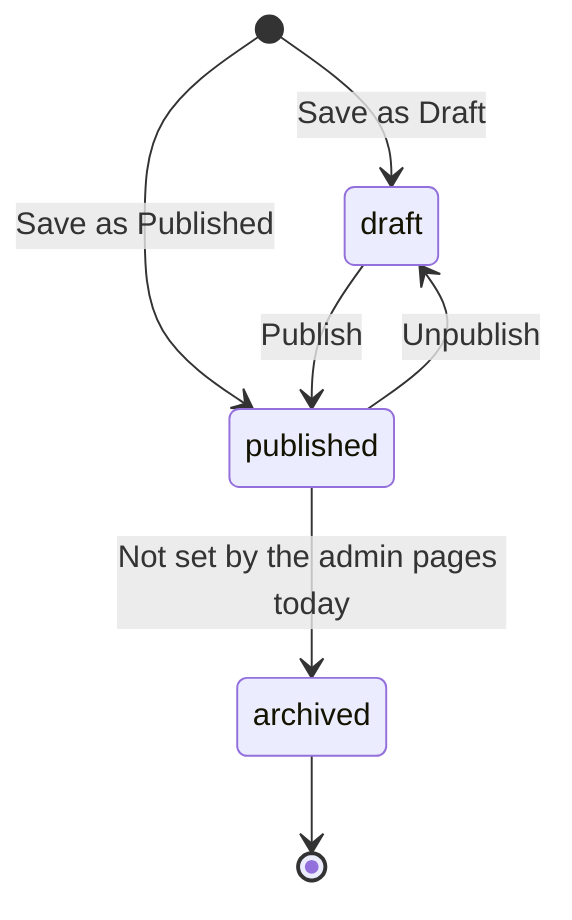
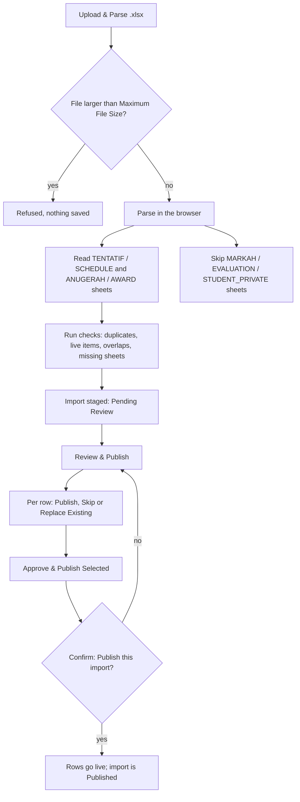
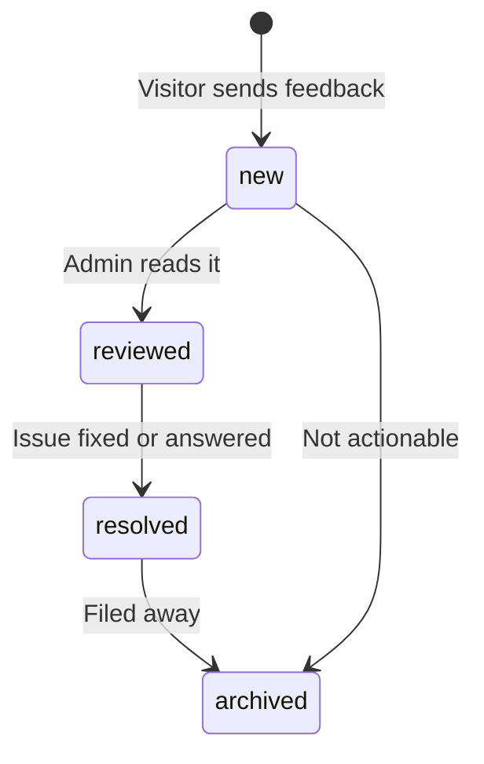
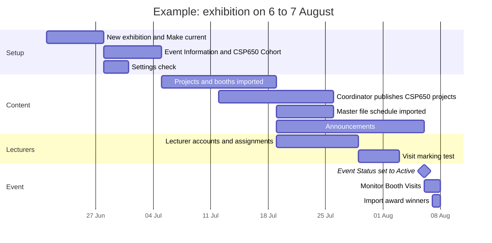

# Exhibition admin guide

This guide is for the **exhibition admin**: the person who runs the public FYP
exhibition site. It covers event details, the schedule, announcements, award
winners, projects and booths, the master Excel import, lecturer assignments and
booth visits, feedback and settings.

The FYP Workspace side (semesters, records, marks, publishing CSP650 projects)
is in the [Coordinator guide](coordinator.md).

## Getting in

1. Go to `https://fskmjasinfypexhibition.site/admin`. (The shortcut
   `admin.fskmjasinfypexhibition.site` takes you to the same place.)
2. If you are not signed in, you are sent to **Sign In**. Enter your
   **Official Email** and password.
3. If two-step verification is on for your account, enter the code from your
   authenticator app. Admin powers only work after the code is entered; the
   database checks this, not just the screen.

Setting up two-step verification, changing your password and the display name
are explained in [Accounts and sign-in](accounts.md).

!!! warning "Signed in with the wrong account?"
    If you open `/admin` while signed in as a student or lecturer, the sign-in
    page shows: "You're signed in as *your email*, which isn't an admin
    account. Sign in with an admin account to open this page." Click **Switch
    Account** to sign out and sign in again with your admin account.

!!! info "Who is an admin"
    An admin is an account whose type is **Admin**. Admins change account
    types in **Users & Roles** (see [System](#system)). A brand-new admin or
    lecturer login is first created in Supabase Authentication by an existing
    admin.

## The admin menu at a glance

The sidebar (or the drawer on a phone) is labelled **EXHIBITION ADMIN**. At the
bottom are **Send Feedback** and **Exhibition Site** (back to the public site).

**Menu items and routes**

| Group | Menu item | Route | Use it to |
|---|---|---|---|
| (top) | Overview Dashboard | `/admin` | Counts, quick actions and recent imports |
| Exhibition | Event Information | `/admin/event` | Dates, venue, status, FAQ; the current exhibition |
| Exhibition | Schedule Management | `/admin/schedule` | Add and edit schedule slots |
| Exhibition | Announcements | `/admin/announcements` | Post and pin announcements |
| Exhibition | Award Winners | `/admin/awards` | Award categories and winners |
| Projects & booths | Project Catalogue | `/admin/projects` | Add, edit and import projects |
| Projects & booths | Booth Management | `/admin/booths` | Register booths and allocate projects |
| Projects & booths | Import Master File | `/admin/imports` | Load schedule and award winners from the Excel master file |
| Lecturers & visits | Lecturer Management | `/admin/lecturers` | Lecturer profiles for visit marking |
| Lecturers & visits | Lecturer Assignments | `/admin/assignments` | Who supervises or examines which project |
| Lecturers & visits | Booth Visits | `/admin/visits` | Monitor visits, void mistakes, export CSV |
| Lecturers & visits | My Visits (Lecturer) | `/lecturer/visits` | Mark your own visits, like a lecturer |
| System | Users & Roles | `/fypms/coordinator/users` | Account types and academic roles (opens in the Workspace) |
| System | Feedback | `/admin/feedback` | Visitor feedback and issue reports |
| System | Audit Log | `/admin/audit` | Who changed what on the exhibition |
| System | Settings | `/admin/settings` | Import limits and visit tracker settings |
| System | FYP Management | `/fypms/coordinator` | Jump to the Coordinator section of the Workspace |

## Overview Dashboard

The dashboard shows six counts: **Total Projects**, **Booths Available**,
**Event Schedules**, **Files Imported**, **FYP Records** and **Pending
Requests**.

- **Quick Actions**: **Import New Master File**, **Update Event Details**,
  **Manage Event Schedules** and **Review Student Projects**.
- **FYP Management**: shortcuts to **Coordinator Dashboard**, **All FYP
  Records**, **Supervision Requests** and **Assignments**.
- **Recent Import History**: the latest imports, each marked **Pending
  Review** or **Published**.

## Exhibition

### Event Information

**Update Event Information** holds everything the public site says about the
event.

**General Information Form fields**

| Field | Notes |
|---|---|
| Exhibition Title | Required |
| Session / Semester Label | For example "Semester 2026/1" |
| Start Date / End Date | Tap to pick. The end date must not be before the start date |
| Daily Hours | For example "9:00 AM – 5:00 PM" |
| Primary Venue / Hall, Location Details | Building, floor, parking |
| Map Link | Must be an `http(s)` link |
| Description | Shown on the public site |
| Public Contact Email | Must look like an email address |
| Hero Image URL, Poster URL | Must be `http(s)` links |
| Event Status | **Draft**, **Upcoming**, **Active (running)**, **Completed** or **Archived** |
| CSP650 Cohort → Semester | Whose CSP650 students exhibit at this event, or **Not linked** |
| Event FAQ | **Add question**; each needs a **Question** and an **Answer** |

Click **Save Changes**. You see "Event information saved."

!!! tip "Link the CSP650 cohort"
    Set **CSP650 Cohort** to the semester whose CSP650 students exhibit. The
    coordinator's **Expo Publications** then offers only that cohort. See the
    [Coordinator guide](coordinator.md#expo-publications).

#### The current exhibition

The **Exhibitions** section on the same page lists every exhibition, one per
year. Exactly one is **current**: the public site, the admin pages and imports
all work on it.

1. To add next year's exhibition, click **New exhibition**. Enter the **Slug
   (e.g. fskm-fyp-2027)**, **Title**, **Venue (optional)** and the first and
   last day. Click **Create**. You see "Exhibition created. Make it current
   when it is ready."
2. When it is ready, click **Make current** on it, then **Switch** in **Switch
   the current exhibition**.

The previous exhibition keeps its projects, booths and winners and moves to
the public Past Exhibitions page.

### Schedule Management

1. Click **Add Slot**.
2. Fill in **Slot Title (e.g. Jury Briefing)**, **Brief Description**, **Venue
   (e.g. Blok Kuliah, FSKM)** and **Target Audience (e.g. Students, Jury)**.
3. Pick the day and the start and end times.
4. Choose **Public** or **Internal (Committee/Jury)**, and **Published** or
   **Draft**.
5. Click **Save**.

The **Existing Slot List** groups slots by day. Use the edit and delete
buttons on each slot. Most schedules come from the
[master file import](#import-master-file).

### Announcements

1. Click **Create Announcement**.
2. Fill in **Announcement Title**, **Announcement Body (Description)** and
   **Category (e.g., Important, Logistical, General)**.
3. Tick **Pin Announcement (Display at the top)** if it should stay on top.
4. Choose **Published** or **Draft** and click **Save**.

**All Announcements** lists them with their date and category.

### Award Winners

The page **Exhibition Award & Category Listings** has two parts.

**Award Categories**

1. Click **Add category**.
2. Enter the **Title (e.g. Gold Innovation Award)**, **Description
   (optional)** and **Display order (lower first)**.
3. Tick **Shown on the public Awards page** to show it.
4. Click **Save**.

**Award winner records**

1. Click **Add Record**.
2. Fill in **Category / Award Name**, choose the **Award category**, and
   **Select Project** for **Winning Project (required)**.
3. Optionally fill in **Sponsor / Partner (e.g. Petronas, Maybank)** and
   **Description / Additional Notes**.
4. Choose **Published** or **Draft** and click **Save**.

Winners can also come from the master file import.

### Draft, published and archived content

Schedule slots, announcements, award winners and projects all have a
publication status. Only **Published** items appear on the public site.

The edit forms offer **Published** and **Draft** only. The database also has
an **archived** status, but the admin pages do not set it today. Old content
is kept with its exhibition when you switch the current exhibition.

## Projects & booths

### Project Catalogue

**Student Project Catalogue** lists all projects in the current exhibition.

To add or edit a project, click **Add Project** or the edit button. The form
has **Project Title**, **Matric ID**, **Programme Code**, **Programme Name**,
**Student Name(s) (comma-separated)**, **Supervisor Name**, **Examiner Name**,
**Short Description**, **Project Category**, **Technology Tags
(comma-separated)**, **Demo URL**, **Cover Image URL**, **Booth Number (e.g.,
A-01)**, **Booth Zone (e.g., Zone A)**, **Highlight as Featured Project** and
**Publication Status:**. Fields the form does not show are kept when you save.

CSP650 projects published by the coordinator from the Workspace also appear
here.

#### Import projects and booths

1. Click **Import** next to **Add Project**.
2. In **Import Projects & Booths**, click **Choose file** and pick the master
   file (`.xlsx`) or a CSV. The project sheet is the one whose name contains
   PROJEK, PROJECT, BOOTH or GERAI, otherwise the first sheet.
3. Row 1 must be a header. Columns are matched by name in English or Malay:
   Title (required), Students, Matric, Programme, Supervisor, Examiner, Booth,
   Zone, Category, Tags, Description, Day. Separate several students or tags
   with `;` or `,`.
4. Read the preview. Each row is **New**, **Already listed — skipped**, **Will
   update** or a problem.
5. Tick **Update projects already listed** to update matching titles, and
   **Publish new projects and booths now (otherwise drafts)** to publish
   straight away.
6. Click **Import N**.

### Booth Management

**Booth & Project Mapping List** shows each booth and its project.

1. Click **Register Booth**.
2. Enter the **Booth Number (e.g., A-01, B-12)**, **Zone (e.g., Zone A, Zone
   B, Sector C)** and **Location Note (Short physical description)**.
3. Choose the **Allocated Project:** or leave it **No Project Allocated /
   Vacant**.
4. Click **Save**.

### Import Master File

The master file import loads **schedule items and award winners** from the
faculty's Excel workbook. Projects and booths use the
[project import](#import-projects-and-booths) instead.

The workbook is read in your browser. Only these sheets are used:

**Sheets the parser reads**

| Sheet name contains | Read as | Columns (by position, row 1 is the header) |
|---|---|---|
| `TENTATIF` or `SCHEDULE` | Schedule | A Day, B Time, C Title, D Venue, E Audience |
| `ANUGERAH` or `AWARD` | Award winners | A Award, B Team, C Supervisor, D Programme, E Project title |
| `MARKAH`, `EVALUATION` or `STUDENT_PRIVATE` | Skipped as confidential | Not read |

Other sheets are ignored. Other columns, such as student emails or phone
numbers, never leave your browser.

**Import statuses**

| Status | Meaning |
|---|---|
| `pending_review` | Parsed and staged, waiting for your review (shown as **Pending Review**) |
| `published` | Approved rows went live. An import can only be published once |

The status line on each import card in **Staged Imports History** shows the
raw status. A file that fails to parse shows an error and is not saved.

## Lecturers & visits

### Lecturer Management

**Registered Lecturers** lists lecturer profiles used for booth visits.

To add one:

1. Make sure the lecturer already has a login. If not, an admin creates the
   user in Supabase Authentication first.
2. Click **Add Lecturer**.
3. Enter the **Full Name** as it appears on the projects (**NAME AS IN
   PROJECT**) and the **UiTM Email**.
4. Click **Add**. You see "Lecturer *name* added."

If you see "No account found for *email*", the login does not exist yet.

**Backfill Lecturer IDs** links assignments that have no lecturer account to
the lecturer whose name matches exactly. Confirm with **Backfill**.

### Lecturer Assignments

Lecturers can mark visits only for projects they are assigned to, so every
supervisor and examiner pairing needs an assignment.

- **Match from project names** compares each project's supervisor and examiner
  names with lecturer accounts (titles, case, spacing and punctuation
  ignored). It shows names with no account and names that match more than one
  account (never auto-assigned). Click **Create N assignments** to confirm.
- **Assign** adds a lecturer to a project as **Supervisor** or **Examiner**.
- **Remove** deletes an assignment. Visits already recorded are kept.
- Use **Search project, lecturer or booth** to find one.

Projects published from the Workspace get their supervisor and examiner
assigned automatically.

### Booth Visits

**Student Visit Monitoring** shows how visit marking is going.

- Tabs: **Overview**, **By Lecturer**, **By Project**, **Visit Log**.
- Filters: **Role** (All, SV, EX) and **Status** (All, Visited, Not Yet,
  Voided), plus **Search lecturers, projects, students, booths…**.
- **Export CSV** downloads the visits.
- To cancel a wrong visit, click **Void Visit**, enter a **Reason \*** and
  click **Void**. This cannot be undone.

The page does not refresh by itself; reload it to see new visits.

### My Visits (Lecturer)

Admins can mark their own booth visits like any lecturer. See the
[Lecturer guide](lecturer.md).

## System

### Users & Roles

This opens **Users & Roles** in the FYP Workspace. As an admin you can change
each person's account type (**Admin**, **Lecturer**, **Student**), add or
remove academic roles (including **FYP coordinator**, which only admins can
give) and activate or deactivate accounts. Full steps are in the
[Coordinator guide](coordinator.md#users-roles).

### Feedback

**Feedback Management** lists feedback and issue reports sent with **Send
Feedback** on the site.

1. Open an item. Set the **Status** and write an **Admin Note**.
2. Click **Save**. You see "Feedback updated."
3. Use **Delete** to remove spam. Use **Export CSV** to download the list.

The **Status** list lets you pick any of **New**, **Reviewed**, **Resolved**
and **Archived** at any time; the diagram shows the usual order.

### Audit Log

**Audit Log** shows the latest 300 exhibition actions, newest first, in
Malaysia time: visits marked and voided, imports created and published,
profiles created, exhibitions created and switched, and project imports.

- Search with **Search action, target, details**, filter by **Action**, and
  click **Refresh** to reload.
- The log is read-only.

Workspace actions are in **Audit Logs** in the Coordinator section.

### Settings

**Portal Settings** has two parts. Click **Save Configuration** when done; you
see "Settings saved successfully!" Changes take effect straight away.

**Excel Master File Parsing**

| Setting | Default | Effect |
|---|---|---|
| **Maximum File Size** | `10 MB` | Larger master files are refused before parsing. Accepts e.g. `10 MB`, `500 KB`, `2.5 MB` or plain bytes |
| **Mandatory Worksheet Names** | `TENTATIF, PEMENANG ANUGERAH` | Comma-separated. The import warns when a listed sheet is missing; it still stages |

!!! tip "Use SCHEDULE, AWARD"
    The parser reads sheets whose names contain `TENTATIF` or `SCHEDULE`, and
    `ANUGERAH` or `AWARD`, and treats the English and Malay names alike. Set
    **Mandatory Worksheet Names** to `SCHEDULE, AWARD` so the check matches
    exactly what the parser reads, whichever language the workbook uses.

**Visit Tracker Settings**

| Setting | Default | Effect |
|---|---|---|
| **Enable Student Project Visits** | On | Lets lecturers record visits |
| **Allow visits before the exhibition** | Off | Off: marking opens on the first exhibition day |
| **Allow visits after the exhibition** | Off | Off: marking closes at the end of the last exhibition day |
| **Lecturer Undo Window (Minutes)** | `30` | How long a lecturer can cancel a visit after marking it. Whole number, 1 or more |

### FYP Management

**FYP Management** opens the Coordinator section of the FYP Workspace. From
there, **Exhibition Admin** in the menu brings you back. See the
[Coordinator guide](coordinator.md).

## Tutorials

### Before-the-exhibition timeline

The weeks are typical; adjust them to your event.

**Checklist**

| # | When | Task | Where | Done when |
|---|---|---|---|---|
| 1 | 6 weeks before | Create the exhibition and make it current | Event Information → **New exhibition**, **Make current** | It shows "current" |
| 2 | 5 weeks before | Fill in dates, venue, FAQ; link the **CSP650 Cohort** | Event Information | Saved; status **Upcoming** |
| 3 | 5 weeks before | Check file size and worksheet names | Settings | `SCHEDULE, AWARD` saved |
| 4 | 4 weeks before | Import projects and booths | Project Catalogue → **Import** | Counts look right |
| 5 | 3 weeks before | Ask the coordinator to publish CSP650 projects | [Coordinator guide](coordinator.md#expo-publications) | Projects listed |
| 6 | 3 weeks before | Register or fix booths | Booth Management | Every project has a booth |
| 7 | 2 weeks before | Import the schedule | Import Master File | Import is Published |
| 8 | 2 weeks before | Add lecturers and match assignments | Lecturer Management; Lecturer Assignments → **Match from project names** | No unmatched names |
| 9 | 1 week before | Post announcements | Announcements | Pinned notice shows on the site |
| 10 | 1 week before | Ask a lecturer to test **My Visits** | [Lecturer guide](lecturer.md) | A visit can be marked and undone |
| 11 | Event day | Set **Event Status** to **Active (running)** | Event Information | Public site shows the event live |
| 12 | Event days | Watch visits; void mistakes | Booth Visits | Visit counts rising |
| 13 | After judging | Import or add award winners | Import Master File or Award Winners | Winners published |
| 14 | After the event | Export visits and feedback; set status **Completed** | Booth Visits, Feedback → **Export CSV**; Event Information | Files saved |

### Importing the master file

1. Check **Settings**: **Maximum File Size** is big enough and **Mandatory
   Worksheet Names** is `SCHEDULE, AWARD`.
2. Open **Import Master File** and click **Upload & Parse .xlsx**. Pick the
   workbook.
3. Wait while it says it is parsing. On success you see "Excel parsed and
   staged successfully!" and the review page opens. Otherwise the import also
   appears under **Staged Imports History**; click **Review & Publish** on it.
4. On **Review Master File Import**, read the checks first: warnings come
   before notes. A missing mandatory sheet shows as "The file has no "X"
   worksheet, which Settings lists as mandatory."
5. Go through **Schedule Candidates (TENTATIF)** and **Award Candidates
   (PEMENANG ANUGERAH)**. Each row may carry flags:

    | Flag | Meaning | Default choice |
    |---|---|---|
    | Already live | An identical item is already published | **Skip** |
    | Changes a live item | Same day and title is live with a different time or venue | **Replace Existing** |
    | Duplicate in file | Repeats an earlier row of the same file | **Skip** |
    | Overlaps another item | Same venue at an overlapping time | **Publish** (check it) |
    | No flag | New item | **Publish** |

6. Change any row to **Publish**, **Skip** or **Replace Existing**.
   **Replace Existing** really replaces: it first deletes the live item it
   matches (schedule: same day and same title, or same venue at an overlapping
   time; awards: same award and team), then adds the row.
7. Check **Audit & Privacy Protection Skips** to see which confidential sheets
   were skipped.
8. Click **Approve & Publish Selected**, then **Publish** in **Publish this
   import?**.
9. Check the public schedule and awards pages.

!!! warning "One publish per import"
    An import can only be published once. To fix something afterwards, edit
    the item in Schedule Management or Award Winners, or upload the file
    again as a new import.

Rows with a day or time the parser cannot read are staged but skipped at
publish time. Fix them in the workbook and import again, or add them by hand.

## Troubleshooting

| Problem | Likely cause | What to do |
|---|---|---|
| "…which isn't an admin account" on the sign-in page | Signed in with a student or lecturer account | Click **Switch Account** and sign in as an admin |
| Admin actions fail with a permission error | Two-step verification is on but no code was entered | Sign out and in again with the code ([Accounts](accounts.md)) |
| Upload refused as too large | The file is bigger than **Maximum File Size** | Raise the limit in Settings or shrink the file |
| Import warns a worksheet is missing | A name in **Mandatory Worksheet Names** has no matching sheet | Rename the sheet, or set the setting to `SCHEDULE, AWARD` |
| "No schedule or award rows matched expected sheets" | No sheet name contains TENTATIF, SCHEDULE, ANUGERAH or AWARD | Rename the sheets |
| A schedule row was not published | Its day or time could not be read | Fix the cell (e.g. `9:00 AM - 10:30 AM`) and re-import, or add by hand |
| A live slot disappeared after publishing | A **Replace Existing** row matched it | Re-add it by hand; check defaults before publishing |
| **Approve & Publish Selected** fails | The import was already published | Upload again as a new import |
| Lecturer "No account found" | The login does not exist yet | Create the user in Supabase Authentication, then add again |
| Lecturer cannot mark a visit | No assignment, visits disabled, or outside the exhibition dates | Check Lecturer Assignments and Visit Tracker Settings |
| **Match from project names** leaves names unmatched | Spelling differs or no lecturer account | Add the lecturer, or **Assign** by hand |
| New visits not showing | The page does not live-update | Reload **Booth Visits** |
| Public site still shows last year | The new exhibition is not current | **Make current** in Event Information |
| Coordinator cannot find CSP650 records to publish | **CSP650 Cohort** linked to the wrong semester | Fix it in Event Information |
| Item not on the public site | It is a **Draft**, or schedule slot is **Internal (Committee/Jury)** | Set it to **Published** and **Public** |

## Related guides

- [Accounts and sign-in](accounts.md)
- [Coordinator guide](coordinator.md)
- [Lecturer guide](lecturer.md)
- [Student guide](student.md)
- [Handbook home](../index.md)
