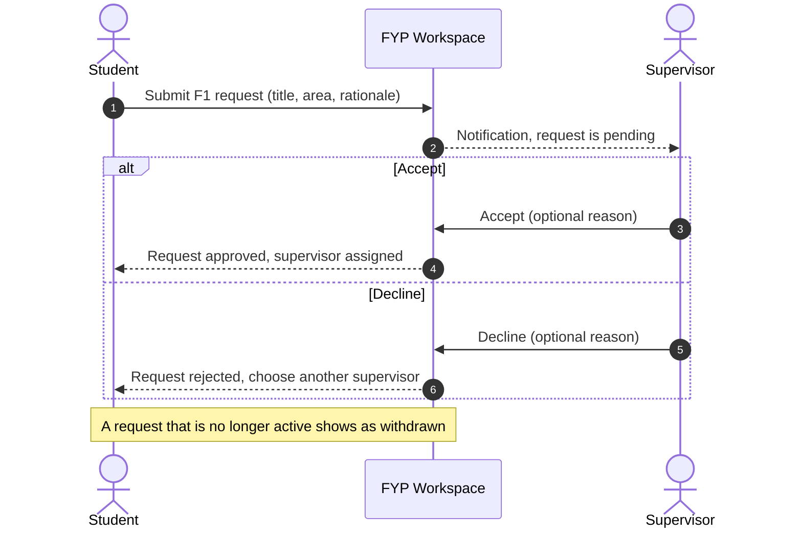
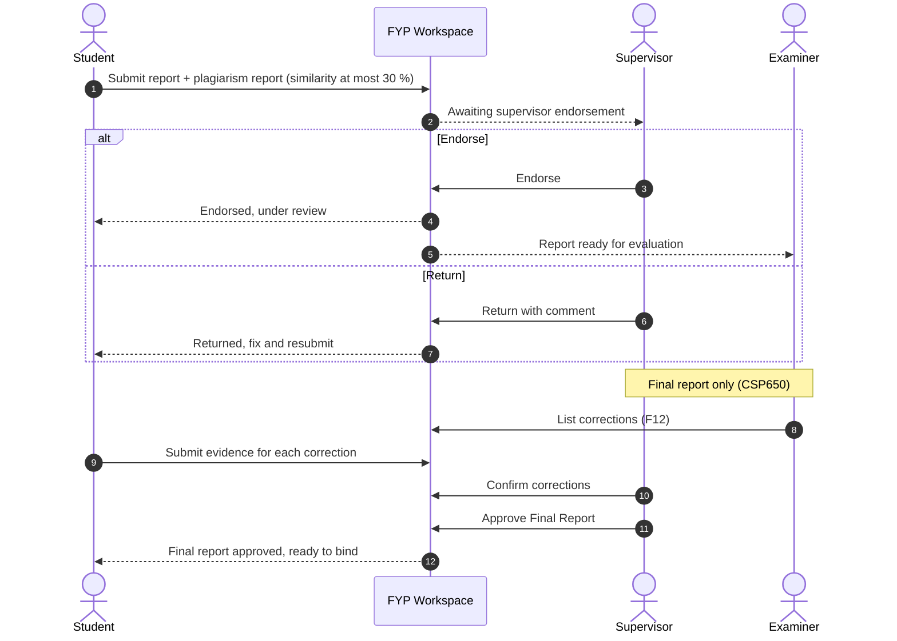
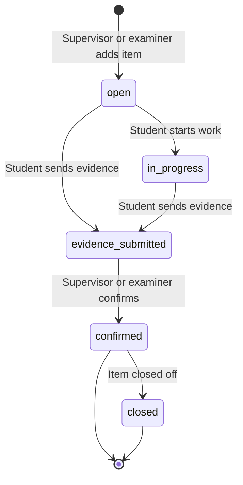
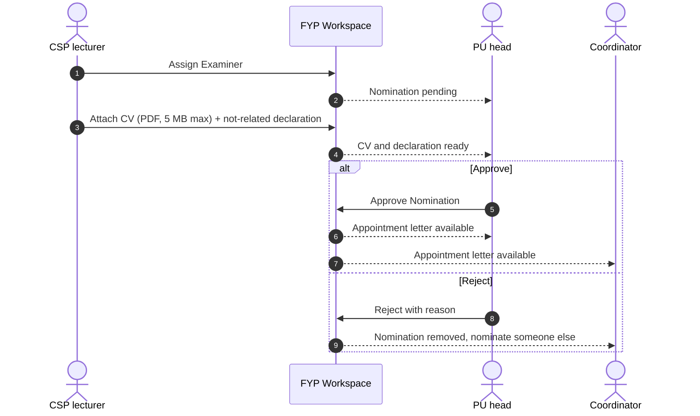
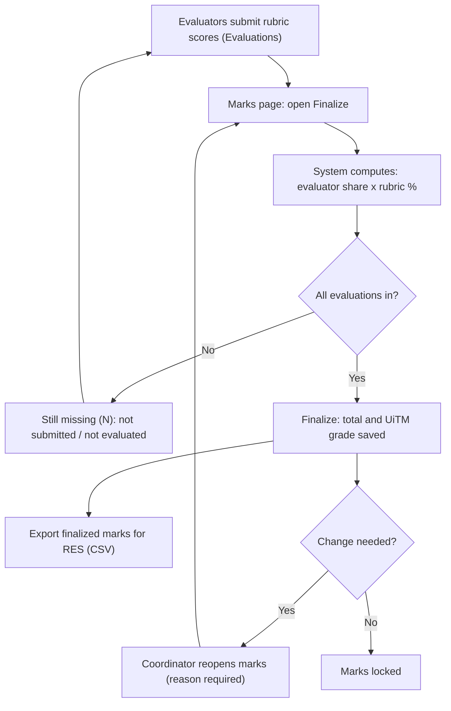
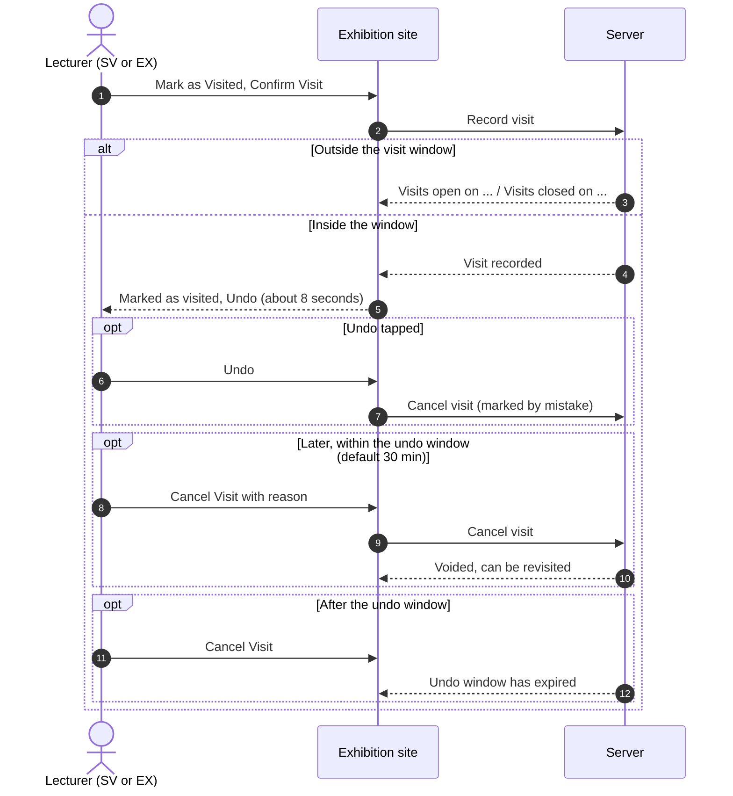

# Lecturer guide

This guide is for FSKM lecturers who use FYP Expo Hub as a **supervisor**,
**co-supervisor**, **examiner**, **CSP600 / CSP650 lecturer** or
**Programme Unit (PU) head**, and for marking **booth visits** on
exhibition day.

If you have not signed in before, start with [Accounts and signing in](accounts.md).
For what your students see, read the [Student guide](student.md). The FYP
coordinator's side is in the [Coordinator guide](coordinator.md), and
exhibition set-up (booths, visit windows, lecturer lists) is in the
[Exhibition admin guide](exhibition-admin.md). Back to the [handbook home](../index.md).

## How the system fits together {#overview}

**One account, several roles.** You sign in once with your UiTM account.
The same account can hold several roles at the same time, for example
supervisor for some students, examiner for others, and CSP650 lecturer for
the whole cohort. The coordinator gives you these roles; you do not choose
them.

**The FYP Workspace menu.** The FYP Workspace (CSP600 / CSP650) has a menu
down the left side (on a phone, tap the menu icon at the top left).

- If you hold **one** role, the menu is a plain list.
- If you hold **several** roles, the menu shows **one collapsible section per
  role**: **Supervisor**, **Examiner**, **CSP600 Lecturer** (or **CSP650
  Lecturer**, or **CSP600 & CSP650 Lecturer**), **Programme Unit** and
  **Coordinator**. Tap a section heading to open or close it. A closed
  section shows how many pages it holds. The section for the page you are
  on opens by itself. **COLLAPSE ALL** / **EXPAND ALL** at the top of the
  menu closes or opens every section at once, and the menu remembers which
  sections you left open, even after you reload the page.
- At the bottom of the menu, **Exhibition Site** takes you back to the public
  exhibition.

The top bar holds the **semester selector** (staff lists follow the semester
you choose), the **notification bell**, your account button and **Sign Out**.

**Booth visits are on the exhibition site, not in the Workspace.** On
exhibition day you mark booth visits on the exhibition site under **My
Visits** (on a phone, the **Visits** tab at the bottom). See
[Exhibition day: marking booth visits](#visits).

!!! tip "Where you land after signing in"
    From the day before the exhibition until the day after it, a lecturer
    with booth visits lands on **My Visits**. The rest of the year you land
    in the Workspace, on the first of these you hold: Supervisor, Examiner,
    CSP lecturer, Coordinator, Programme Unit. You can always open
    `/fypms` to go to your Workspace home.

**Which pages each role sees**

| Menu section | Pages (exact menu labels) | Address |
|---|---|---|
| **Supervisor** | Supervisor Dashboard, Assigned Records, Supervision Requests; *Review:* Progress Reviews, Report Endorsement, Evaluations, Corrections, Milestones | `/fypms/supervisor/...` |
| **Examiner** | Examiner Dashboard, Assigned Records, Evaluations, Corrections | `/fypms/examiner/...` |
| **CSP600 / CSP650 Lecturer** | CSP600 Dashboard (or CSP650 Dashboard), Offerings, Supervision Requests; *Cohort:* Examiners & Handover (CSP600 only), Nomination CVs, Milestones; *Assessment:* Presentations, Evaluations, Marks | `/fypms/csp/...` |
| **Programme Unit** | Nominations | `/fypms/pu` |

Co-supervisors use the **Supervisor** section. There is no separate
co-supervisor menu.

---

## Supervisor {#supervisor}

### What you can do

| Task | Page |
|---|---|
| Accept or decline a student's supervision request (F1) | **Supervision Requests** |
| See the students you supervise | **Supervisor Dashboard** / **Assigned Records** |
| Validate or reject weekly consultation logs (F5) | **Progress Reviews** |
| Endorse or return a proposal or final report (F6) | **Report Endorsement** |
| Score forms with the rubric (F7, F8, F10, F11, F13, F15, F16) | **Evaluations** |
| List corrections, confirm the student's fixes (F12) and approve the final report | **Corrections** |
| See your students' milestones and their status | **Milestones** |

### Approve a supervision request {#approve-supervision}

[Open Supervision Requests :octicons-link-external-16:](https://fyp.fskmjasinfypexhibition.site/fypms/supervisor/requests){ .md-button target=_blank rel=noopener }

A student sends you an F1 Mutual Acceptance request when they choose you as
their supervisor. You get a notification.

1. In the **Supervisor** section, open **Supervision Requests**.
2. Read the card: project title, **Area**, **Supervisor**, **Co-supervisor**
   (if the student named one) and the student's **Rationale**.
3. Optionally type a **Reason (optional)**. The student sees it.
4. Select **Accept**, or **Decline**.
5. A message confirms: *Supervision accepted.* or *Request declined.*

Accepting makes you the student's supervisor (and the co-supervisor, if one
was named, becomes co-supervisor). The record moves on from
*supervision requested* to *supervision approved*.

!!! note "Programme Unit approval"
    If your programme has a PU head, the new supervisor and co-supervisor
    appointments wait for the PU to approve them (see
    [Programme Unit head](#pu)). You can already work
    with the student while the PU decides.

Click a step to see what it means and who acts next.

**Supervision request statuses**

| Status | Shown on the card as | Meaning |
|---|---|---|
| pending | Accept / Decline buttons | Waiting for the named supervisor |
| approved | **Accepted** | You accepted; you are now the supervisor |
| rejected | **Declined** | You declined; the student must ask someone else |
| withdrawn | **Withdrawn** | The request is no longer active |

### Review consultation logs (F5) {#consultation-logs}

[Open Progress Reviews :octicons-link-external-16:](https://fyp.fskmjasinfypexhibition.site/fypms/supervisor/progress){ .md-button target=_blank rel=noopener }

1. Open **Progress Reviews**. Each project lists its logs by week (**W1**,
   **W2**, ...), with the meeting date, the summary and the **Next:** plan.
2. On a log marked *submitted*, select **Review**.
3. In **Review Progress Log**, choose a **Decision**: **Validate** or
   **Reject**.
4. Add a **Validation Comment (optional)**, or, when rejecting, the
   **Reason For Rejecting (required)**.
5. Select **Submit**.

Log statuses: *draft*, *submitted*, *validated*, *rejected*.

### Endorse a report (F6) {#endorse-report}

[Open Report Endorsement :octicons-link-external-16:](https://fyp.fskmjasinfypexhibition.site/fypms/supervisor/reports){ .md-button target=_blank rel=noopener }

Before a proposal or final report goes for review, you check the report and
its plagiarism report. The similarity index must be **30 % or less**; the
system will not let the student submit a higher one.

1. Open **Report Endorsement**. Reports are grouped by project.
2. On a report showing **Awaiting supervisor endorsement**, open the
   **Report** and the **Plagiarism report** links (and the **REC ethics
   form**, if attached).
3. Type a **Comment (required to return)** if you want to return it.
4. Select **Endorse**, or **Return**. Returning without a comment shows
   *Say why the report is returned.*
5. A message confirms: *Report endorsed.* or *Report returned to the student.*

Click a step to see what it means and who acts next.

**Report statuses**

| Status | Shown as | Meaning |
|---|---|---|
| submitted | **Awaiting supervisor endorsement** | Your turn: endorse or return |
| under_review | **Endorsed — under review** | You endorsed it; it is with the evaluators |
| approved | **Approved** | The report is accepted |
| rejected | **Returned** | You returned it; the student resubmits a new version |

### Corrections and final approval (F12, CSP650) {#corrections}

[Open Corrections :octicons-link-external-16:](https://fyp.fskmjasinfypexhibition.site/fypms/supervisor/corrections){ .md-button target=_blank rel=noopener }

After the final presentation, the supervisor or examiner lists the
corrections. The student fixes each one and uploads evidence. You confirm
each item, and then sign off the final report.

**Add a correction**

1. Open **Corrections**. Find the project and select **Add Correction**.
2. In **New Correction Item**, type the **Correction**, choose the
   **Severity** (**Minor** or **Major**) and, if it relates to a form,
   pick the **Form Submission (optional)**.
3. Select **Create**. The item gets a code such as `CORR-1a2b3c4d`.

**Confirm a correction**

1. When the student has sent evidence, the item shows their note
   (**Student:** ...) and an **Evidence file** link, and a **Confirm** button.
2. Select **Confirm**, add **Notes (optional)** and select **Confirm** again.
3. The item shows a green tick.

**Approve the final report**

At the bottom of each CSP650 project on the **Corrections** page there is a
**Supervisor approval** box.

1. Wait until every correction item is confirmed. Until then the box says
   *Approval opens once all N open correction items are confirmed (F12).*
2. When it says *Corrections confirmed (F12). Ready for your approval.*,
   select **Approve Final Report**.
3. In **Approve the Final Report?**, select **Approve Final Report**. This
   records your signature on the Supervisor Approval page.
4. The box changes to *Final report approved on dd-mm-yyyy*.

!!! note "Main supervisor only"
    Only the student's main supervisor can approve the final report. A
    co-supervisor sees *Only the main supervisor can give final approval.*
    instead of the button.

Click a step to see what it means and who acts next.

**Correction statuses**

| Status | Shown as | What you do |
|---|---|---|
| open | *open* | Nothing yet; the student has not started |
| in_progress | *in progress* | Nothing yet; the student is working on it |
| evidence_submitted | **Confirm** button | Check the evidence and confirm |
| confirmed | green tick | Done |
| closed | green tick | Done; counts as finished for final approval |

### Score evaluations {#evaluations}

[Open Evaluations :octicons-link-external-16:](https://fyp.fskmjasinfypexhibition.site/fypms/supervisor/evaluations){ .md-button target=_blank rel=noopener }

1. Open **Evaluations**. Each project lists the forms you score.
2. Select **Evaluate** next to a form. The **Evaluate Submission** dialog
   shows the **Student submission** and the rubric.
3. Give each criterion a **Score** from 0 to 10 (*8–10 Excellent, 6–7 Good,
   5 Satisfactory, 1–4 Poor, 0 No evidence*). The total updates as you go.
4. Choose a **Decision** (**Approved**, **Rejected** or **Resubmission
   Required**) and add **Comments**.
5. **Submit** is enabled once every criterion has a score. You will see
   *Evaluation submitted.*

!!! note
    Some criteria are for the supervisor only; examiners do not see them.
    F15 and F16 show **Not qualified** until the CSP650 lecturer qualifies
    the student on F14 (special evaluation).

**Forms each role scores**

| Form | Supervisor | Examiner | CSP lecturer |
|---|---|---|---|
| F2, F3, F4 | | | yes |
| F7 | yes | yes | yes |
| F8, F10, F11, F15, F16 | yes | yes | |
| F9 | | | yes |
| F13 | yes | | yes |

### Milestones {#supervisor-milestones}

**Milestones** lists each student's milestones with the **Target** date and
a status badge: *pending*, *in progress*, *completed* or *overdue*. The CSP
lecturer sets milestones and decides extension requests; as supervisor you
can only view them here.

### Record statuses you will see

The dashboard shows each record's course and status. Common ones:

| Status | Meaning |
|---|---|
| awaiting supervisor assignment | No supervisor yet |
| supervision requested / supervision approved | F1 sent / accepted |
| proposal submitted / proposal reviewed / proposal defended | CSP600 proposal stages |
| final report submitted / final report reviewed | CSP650 report stages |
| corrections ongoing / corrections completed | F12 in progress / done |
| project pending presentation | A presentation slot is booked |
| project completed / project archived | Finished / archived |
| withdrawn / incomplete | Put on hold by the coordinator |

---

## Co-supervisor {#co-supervisor}

A co-supervisor works from the same **Supervisor** menu section and sees the
same pages for the students they co-supervise.

### What you can do

| Task | Co-supervisor | Main supervisor |
|---|---|---|
| See supervision requests that name you | yes (for information) | yes |
| Accept or decline a supervision request | **no** | yes |
| Validate consultation logs | yes | yes |
| Endorse or return reports | yes | yes |
| Score supervisor forms | yes | yes |
| Add and confirm corrections | yes | yes |
| Approve the final report | **no** | yes |

### How to

1. **Supervision requests.** Open **Supervision Requests**. Cards where you
   are the co-supervisor say *you are named as co-supervisor* and have no
   buttons. Only the main supervisor decides.
2. **Logs, reports, evaluations, corrections.** Follow the same steps as in
   [Supervisor](#supervisor).

The statuses are the same as for the supervisor.

---

## Examiner {#examiner}

### What you can do

| Task | Page |
|---|---|
| See the projects you examine | **Examiner Dashboard** (*Records To Examine*) / **Assigned Records** |
| Score examiner forms (F7, F8, F10, F11, F15, F16) | **Evaluations**  |
| List corrections and confirm the student's fixes (F12) | **Corrections** |
| Score F10 (or F15) at the booth on exhibition day | **My Visits** on the exhibition site |

You cannot be the examiner of a student you supervise or co-supervise. The
CSP600 lecturer or the coordinator assigns examiners.

### How to

1. **Open a record.** On **Examiner Dashboard**, select a project to see its
   course, programme, status, matric ID, description and **Assignments**.
2. **Score a form.** Open **Evaluations** and select **Evaluate**. Follow
   [Score evaluations](#evaluations). Supervisor-only criteria are
   hidden from you.
3. **List corrections.** Open **Corrections**, select **Add Correction**,
   fill in **Correction** and **Severity**, then **Create**.
4. **Confirm corrections.** When the student sends evidence, select
   **Confirm**, add **Notes (optional)** and **Confirm**.

### Statuses you will see

Correction and record statuses are the same as for the supervisor (see the
tables under [Supervisor](#supervisor)).

---

## CSP600 / CSP650 Lecturer {#csp-lecturer}

The menu section is named after the course you teach: **CSP600 Lecturer**,
**CSP650 Lecturer**, or **CSP600 & CSP650 Lecturer** if you teach both. The
dashboard is **CSP600 Dashboard** (or **CSP650 Dashboard**).

### What you can do

| Task | Page | Course |
|---|---|---|
| See your course offerings | **CSP600 Dashboard** / **Offerings** | both |
| Monitor pending supervision requests (read-only) | **Supervision Requests** | both |
| Assign or change examiners | **Examiners & Handover** | CSP600 |
| Hand the cohort over to CSP650 | **Examiners & Handover** | CSP600 |
| Attach the nominee's CV and declaration for the PU | **Nomination CVs** | both |
| Set milestones and decide extension requests | **Milestones** | both |
| Create presentation sessions and slots | **Presentations** | both |
| Score course-lecturer forms (F2, F3, F4, F7, F9, F13) and decide F14 | **Evaluations**  | both |
| Compute, finalize and export marks | **Marks**  | both |

!!! note "Supervision requests"
    You see pending F1 requests for your course so you can follow up, but
    you cannot accept or decline them. The chosen supervisor decides.

### Nominate an examiner with a CV {#nominate}

[Open Nomination CVs :octicons-link-external-16:](https://fyp.fskmjasinfypexhibition.site/fypms/csp/nominations){ .md-button target=_blank rel=noopener }

Assigning an examiner (or a supervisor accepting a student) is a
**nomination**. If the programme has a PU head, the PU must approve it, and
the PU can only approve once the **nominating lecturer** has attached the
nominee's **CV** and the **"not related" declaration**. The nominating
lecturer is the CSP lecturer of the student's course (or the coordinator).

**Step 1: assign the examiner (CSP600)**

1. Open **Examiners & Handover**. Each CSP600 project shows its
   **Supervisor** and **Examiner** (*not assigned* in red if missing).
2. Select **Assign Examiner** (or **Change Examiner**).
3. Pick the **Examiner** from the list and select **Assign Examiner**.
4. A message confirms *Examiner assigned.* The system refuses the student's
   own supervisor or co-supervisor.

**Step 2: attach the CV and declaration**

1. Open **Nomination CVs**. It lists every nomination waiting for the PU,
   for example *Examiner: Dr Aminah — Project title · Student name*.
2. A nomination without documents says *Waiting for the CV and declaration
   from the nominating lecturer.*
3. Select **Attach CV**.
4. In **Attach CV and Declaration**, select **Choose CV (PDF)**. The CV must
   be a **PDF of 5 MB or less**; a larger file shows *The CV must be a PDF of
   5 MB or less.* The CV should list about two years of supervision, or,
   for staff with none yet, their expertise in the project area (FSKM
   handbook, Appendix N).
5. Tick *I declare the nominee is not a relative or close friend of the
   student or of the other supervisors.*
6. Select **Send to PU**. You will see *CV and declaration sent to the PU.*
7. The card now shows **View CV** and *Declared not a relative or close
   friend on dd-mm-yyyy*. To swap the file, select **Replace CV**.

**Step 3: the PU decides** (see [Programme Unit head](#pu)).

Click a step to see what it means and who acts next.

!!! info "The nominee can start at once"
    A pending nomination still works: the examiner can see and score the
    student while the PU decides. A rejected nomination is removed from the
    record.

### Hand the cohort over to CSP650 (CSP600) {#handover}

[Open Examiners & Handover :octicons-link-external-16:](https://fyp.fskmjasinfypexhibition.site/fypms/csp/cohort){ .md-button target=_blank rel=noopener }

At the end of the semester, each student whose CSP600 marks are finalized
and passed gets a CSP650 record in the next semester, keeping the title,
supervisors and examiner.

1. Open **Examiners & Handover** and select **Hand Over Cohort to CSP650**.
2. Choose the **CSP650 semester** and select **Hand Over**.
3. The dialog lists any record that could not move and why (most often:
   marks not finalized, or not passed).

To move one student only, use **Promote to CSP650** on their card.

### Set milestones and decide extensions {#csp-milestones}

[Open Milestones :octicons-link-external-16:](https://fyp.fskmjasinfypexhibition.site/fypms/csp/milestones){ .md-button target=_blank rel=noopener }

1. Open **Milestones**. Choose the student
   from **Record:**.
2. Select **Add**, fill in **Milestone Code**, **Title**, **Description**,
   the target date and **Status** (**Pending**, **In Progress**,
   **Completed**, **Overdue**), then **Save**.
3. To give every student in the same course the same milestones, select
   **Copy to All Students**, then **Copy Milestones**. Running it again is
   safe; milestones with the same code are updated.
4. If the student asked for more time, an **Extension requests (N)** box
   appears above the list. Select **Approve** (the target date moves), or
   **Reject** and type the **Reason for the student**.

Extension statuses the student sees: *Extension to dd-mm-yyyy pending*,
*Extension approved to dd-mm-yyyy*, *Extension rejected: reason*.

### Presentations {#csp-presentations}

[Open Presentations :octicons-link-external-16:](https://fyp.fskmjasinfypexhibition.site/fypms/csp/presentations){ .md-button target=_blank rel=noopener }

Open **Presentations** and select **New Session** to create a session, then
open it and select **Schedule Slot** to book a student (**FYP Record**,
**Slot Number**, start and end time, **Room (optional)**). Use the menu on a
session to **Edit…** or **Delete…** it.

### Score evaluations and decide F14 {#csp-evaluations}

1. Open **Evaluations**. Score your forms with **Evaluate** as described in
   [Score evaluations](#evaluations).
2. **CSP650 only:** each project has an **F14 — Special evaluation** row.
   Select **Check** to see the four checks (Progress F9 + Lean Model Canvas
   F13 at least 7.5 %, complete chapters 1–5 submitted, presented at the
   exhibition, final semester with all other courses passed), add a
   **Note (optional)** and **Save**. A qualified student can then be scored
   on F15 and F16.

### Finalize marks {#finalize-marks}

[Open Marks :octicons-link-external-16:](https://fyp.fskmjasinfypexhibition.site/fypms/csp/marks){ .md-button target=_blank rel=noopener }

1. Open **Marks**. Each project without finalized marks has a **Finalize**
   button.
2. Select **Finalize**. The **Finalize Course Marks** dialog shows each
   evaluator's share times their rubric score, and **Still missing (N)** for
   any form *not submitted* or *not evaluated*.
3. When every evaluation is in, the **Total** and grade appear and the
   **Finalize** button is enabled. Select it. You will see *Marks finalized.*
4. Finalized marks show as *CSP600 — Grade: A* with the **Weighted Total**.
5. To upload to RES, select the download icon (**Export finalized marks for
   RES (CSV)**).

!!! warning "Finalized marks are locked"
    Only the coordinator can reopen finalized marks, with a reason. You are
    notified to finalize again. CSP600 marks of a student already promoted to
    CSP650 stay locked.

---

## Programme Unit head (PU) {#pu}

The PU head approves supervisor, co-supervisor and examiner nominations for
their programme, and issues appointment letters.

### What you can do

| Task | Where |
|---|---|
| Approve or reject pending nominations | **Nominations** → **Awaiting approval** |
| Download appointment letters | **Nominations** → **Approved · letters** |

### Approve or reject a nomination {#pu-decide}

[Open Nominations :octicons-link-external-16:](https://fyp.fskmjasinfypexhibition.site/fypms/pu){ .md-button target=_blank rel=noopener }

1. In the **Programme Unit** section, open **Nominations**. The
   **Awaiting approval** tab lists each nomination as *Role: Lecturer name*,
   with the project, student, matric ID, programme and course.
2. Check the documents. **View CV** opens the nominee's CV, and the line
   *Declared not a relative or close friend on dd-mm-yyyy* shows the
   declaration.
3. To approve, select **Approve**, then **Approve Nomination** in
   **Approve This Nomination?**. You will see *Nomination approved.* This
   creates the appointment and its letter and cannot be undone from this
   page.
4. To reject, select **Reject**, type the **Reason for the FYP
   coordinator** and select **Reject**. You will see *Nomination rejected.*
   The nomination is removed and the coordinator nominates someone else.

!!! note "Approve needs the CV and declaration"
    **Approve** stays greyed out while the card says *Waiting for the CV and
    declaration from the nominating lecturer.* Ask the CSP lecturer of the
    course to attach them under **Nomination CVs**. You can still **Reject**.

### Download appointment letters {#letters}

1. Open the **Approved · letters** tab. Each approved appointment shows the
   role, lecturer, project, student and *Approved dd-mm-yyyy*.
2. Select **Letter** for one letter, or **All N letters** for all of them.
3. Letters download as a web page. Open it and print, or save as PDF.

### Statuses you will see

| Status | Meaning |
|---|---|
| pending | Waiting for you (shown on **Awaiting approval**) |
| approved | You approved it; the letter is on **Approved · letters** |
| rejected | You rejected it; the nomination is no longer active |

---

## Exhibition day: marking booth visits {#visits}

On exhibition day, supervisors (**SV**) and examiners (**EX**) visit their
students' booths and record each visit. This happens on the **exhibition
site**, not in the Workspace. Your list of booths comes from the exhibition
admin, not from the FYP Workspace.

Tick steps as you go; your progress stays in this browser.

**On the day**

- [ ] Sign in on the exhibition site and open **My Visits** (see
  [Open My Visits](#open-my-visits)).
- [ ] Check the **Supervisor (SV)** and **Examiner (EX)** counters, and set
  **Day:** to today.
- [ ] At each booth, open the project and select **Mark as Visited**, then
  **Confirm Visit** ([Mark a visit](#mark-visit)).
- [ ] If the card shows **Score F10** (or **Score F15**), score every
  criterion and **Submit** ([Score F10 at the booth](#score-booth)).
- [ ] Marked the wrong booth? Select **Undo** straight away, or **Cancel
  Visit** within the undo window ([Cancel a visit](#cancel-visit)).
- [ ] Before you leave, set **Status:** to **Not visited** and check that
  no booth is left.

### Open My Visits {#open-my-visits}

[Open My Visits :octicons-link-external-16:](https://fskmjasinfypexhibition.site/lecturer/visits){ .md-button target=_blank rel=noopener }

=== "Desktop"

    1. On the exhibition site, select **Sign In** at the top right and sign
       in with your UiTM account. (During the exhibition you land on **My
       Visits** directly.)
    2. Select **My Visits** in the links across the top. In a narrow window
       it moves into **More**. From the Workspace, use **Exhibition Site** at
       the bottom of the menu on the left.

=== "Phone"

    1. On the exhibition site, tap **Menu** (the last tab at the bottom),
       then **Sign In**, and sign in with your UiTM account. (During the
       exhibition you land on **My Visits** directly.)
    2. Tap the **Visits** tab at the bottom. It replaces the **Staff** tab
       once you are signed in. From the Workspace, tap the three-line icon at
       the top left and choose **Exhibition Site** at the bottom of the menu.

Once **My Visits** is open:

1. The page shows *Welcome, your name* and two counters, **Supervisor (SV)**
   and **Examiner (EX)**, as *visited / total*.
2. Narrow the list with the search box (*Search projects, students,
   booths…*) and the **Role:** (All, SV, EX), **Status:** (All, Not
   visited, Visited, Voided) and **Day:** filters.

If you also hold a Workspace role, the **FYP Workspace** button next to
**Sign Out** takes you back to the FYP Workspace.

### Mark a visit {#mark-visit}

1. Select a project card to open it. The page has a **Supervisor (SV)** card
   and an **Examiner (EX)** card; use the one for your role.
2. Select **Mark as Visited**.
3. In the dialog, check **Project**, **Student**, **Booth** and the role,
   add a **Note (optional)** and select **Confirm Visit** (or **Not Now**).
4. A message says *Student has been marked as visited.* with an **Undo**
   button. It stays for about 8 seconds.
5. The card shows **Visited** and the **Visit Time**.

!!! tip "Tapped the wrong booth?"
    Select **Undo** on the message straight away. The visit is cancelled
    with the reason *Marked by mistake (undone straight away)*.

### Cancel a visit {#cancel-visit}

If the message has gone, you can still cancel your own visit within the
**undo window**, which is **30 minutes by default**. The exhibition admin
sets it under **Lecturer Undo Window (Minutes)**.

1. Open the project and select **Cancel Visit**.
2. Type the **Cancellation reason (required)**, for example *Student not at
   booth*. **Cancel Visit** stays disabled until you do.
3. Select **Cancel Visit** (or **Keep Visit**). You will see *Visit has been
   cancelled. Student can be revisited.*
4. The card shows **Voided** and **Mark as Visited** appears again.

After the window closes, the system refuses with *The undo window for this
visit has expired.* Ask the exhibition admin to cancel it.

Click a step to see what it means and who acts next.

### When you can mark visits

Visits can only be marked **inside the open/close window** the exhibition
admin sets. By default that is the exhibition days (Malaysia time). Outside
it you will see *Visits open on 08 Aug 2026 09:00.* or *Visits closed on
...*, and if visits are switched off, *Student project visits are currently
disabled.*

### Score F10 (or F15) at the booth {#score-booth}

If the exhibition project is linked to the student's FYP record, your card
also shows **Score F10 (final presentation)**, or **Score F15 (special
evaluation)** for a student qualified on F14.

1. Select the score button. The rubric dialog opens, as in
   [Score evaluations](#evaluations).
2. Score every criterion and select **Submit**.
3. The button then reads *F10 scored · 82.5% — update*. Select it to change
   your scores.

### Visit statuses

| On the list | On the project | Meaning |
|---|---|---|
| **Not visited** | **Not visited** | No visit recorded |
| time, for example **10:42** | **Visited** | Visit recorded at that time |
| **Voided** | **Voided** | Visit cancelled; you can mark it again |

---

## Troubleshooting

| Problem | Likely cause | What to do |
|---|---|---|
| A menu section is missing | Your role has not been given yet | Ask the FYP coordinator to add the role under **Users & Roles** |
| *No FYPMS Access* after signing in | No active Workspace role | Ask the coordinator; booth visits may still work under **My Visits** |
| A page sends you back to your dashboard | You opened another role's address | Use the menu; each section only opens for its own role |
| A student or project is missing from a list | Wrong semester selected | Change the semester selector in the top bar |
| No **Accept** / **Decline** on a request | You are the co-supervisor, or you are viewing it as CSP lecturer | Only the named main supervisor decides |
| **Return** shows *Say why the report is returned.* | Comment is empty | Type a comment first |
| **Approve Final Report** is greyed out | Some correction items are not confirmed | Confirm every item (F12) first |
| *Only the student's supervisor approves the final report.* | You are the co-supervisor | Ask the main supervisor |
| **Submit** in the rubric is greyed out | A criterion has no score | Score every criterion |
| F15 / F16 shows **Not qualified** | The student is not qualified on F14 | The CSP650 lecturer decides F14 under **Evaluations** |
| **Finalize** in the marks dialog is greyed out | Evaluations missing | Check **Still missing (N)** and chase the evaluators |
| *The CV must be a PDF of 5 MB or less.* | Wrong type or too large | Save the CV as a smaller PDF |
| **Send to PU** is greyed out | No file chosen, or declaration not ticked | Choose the PDF and tick the declaration |
| PU **Approve** is greyed out | CV and declaration not attached | The nominating CSP lecturer attaches them under **Nomination CVs** |
| *Visits open on ...* / *Visits closed on ...* | Outside the visit window | Wait for the window, or ask the exhibition admin |
| *Visit has already been recorded.* | Already marked | Nothing to do; it shows **Visited** |
| *The undo window for this visit has expired.* | More than the undo window has passed | Ask the exhibition admin to cancel the visit |
| *You are not assigned to this role.* | You are not the SV or EX for that project | Use your own role's card, or ask the exhibition admin |
| No **Score F10** button at the booth | The exhibition project is not linked to an FYP record, or you are not its evaluator | Score F10 in the Workspace under **Evaluations**, or ask the coordinator |
| *You have no projects assigned yet.* on **My Visits** | No booth assignments for you | Ask the exhibition coordinator |
