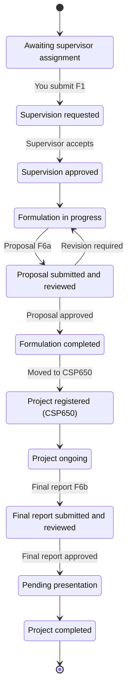
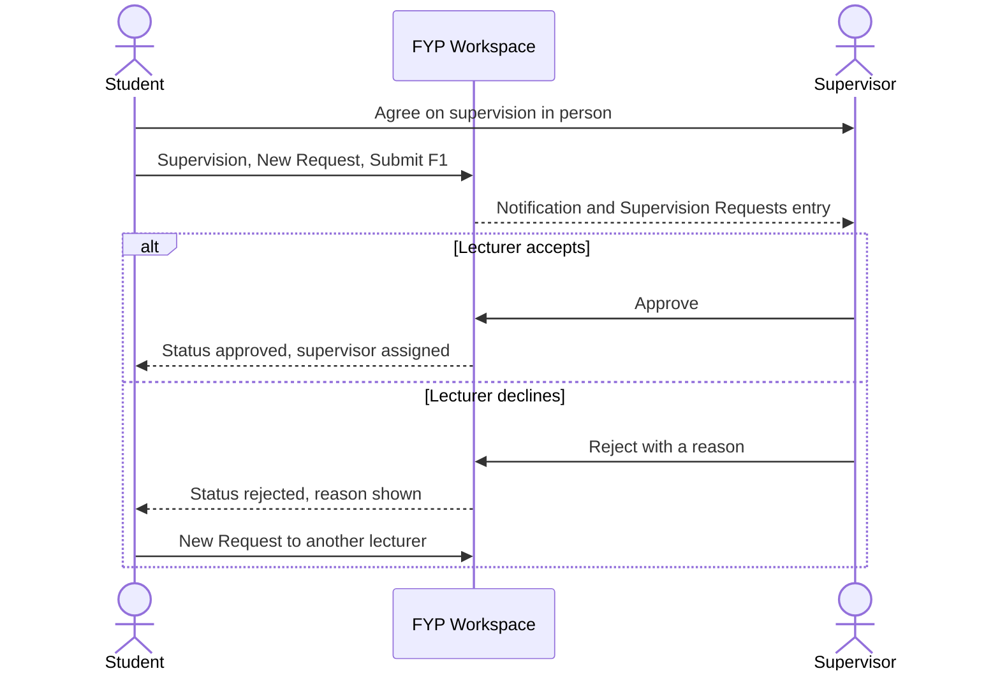
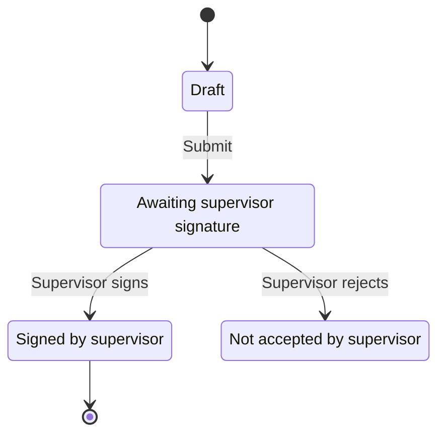
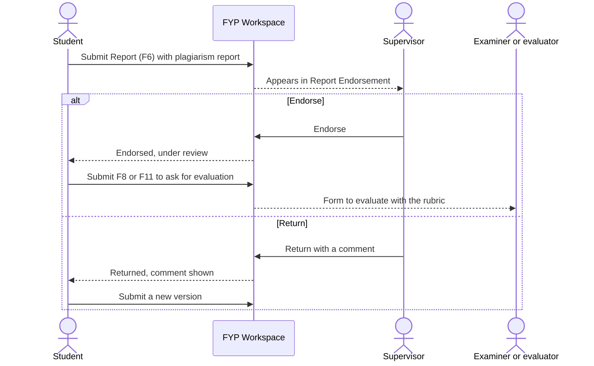
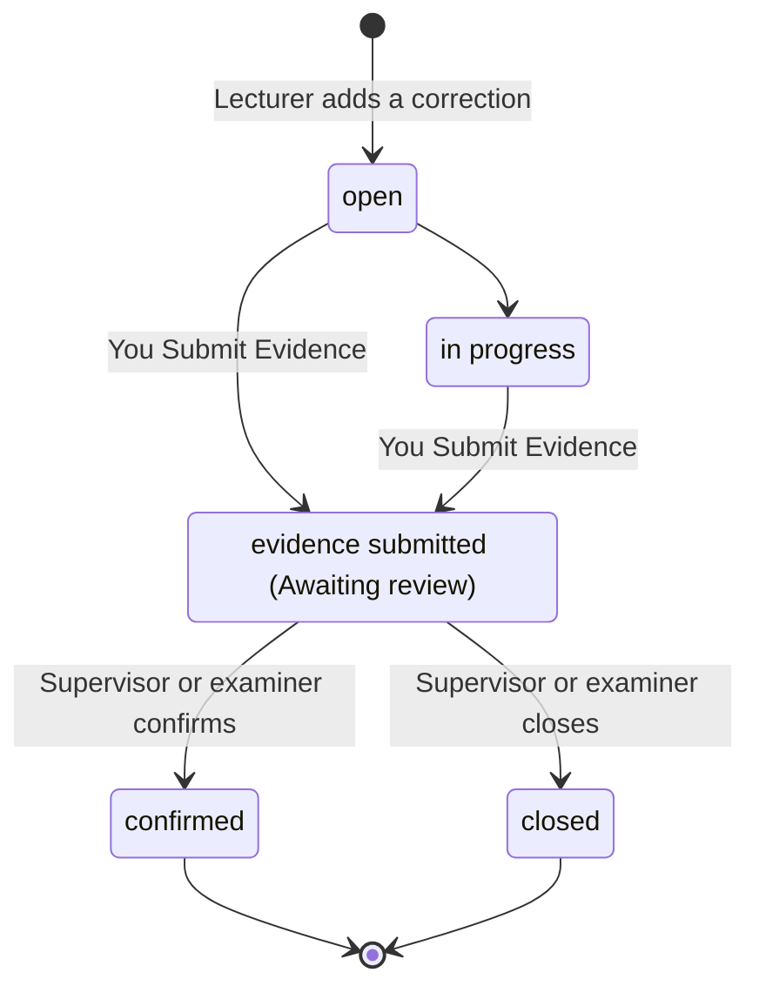
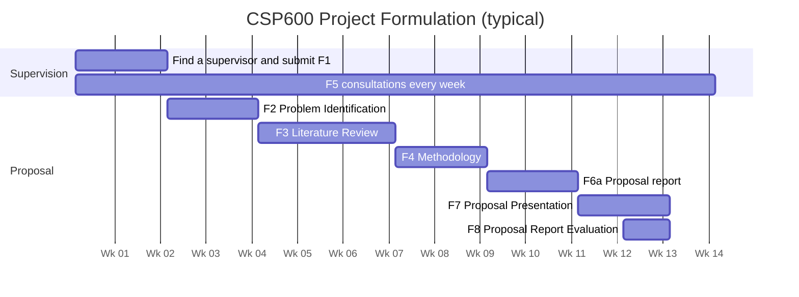
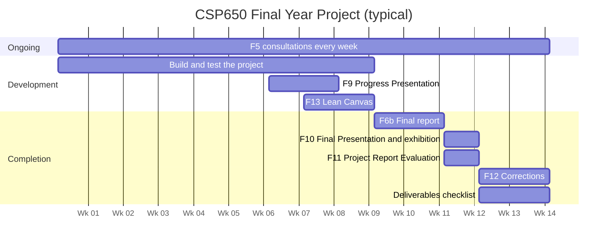

# Student guide (CSP600 and CSP650)

## Who this is for

FSKM final year students taking **CSP600 Project Formulation** or **CSP650
Final Year Project**. The FYP Workspace is where you do your FYP
paperwork: find a supervisor, log your meetings, submit forms and reports,
answer corrections, and see your milestones, presentation slots and marks.

The forms follow the FSKM FYP Text Book (F1 to F16). You do not need to
know the form numbers by heart: each page tells you which form it is.

!!! note "Before you start"
    You need a Workspace account with the **student** role. Your FYP
    coordinator creates it. If you have never signed in, read
    [Accounts and signing in](accounts.md) first.

## 1. Get into the FYP Workspace {#workspace}

[Open Student Dashboard :octicons-link-external-16:](https://fyp.fskmjasinfypexhibition.site/fypms/student){ .md-button target=_blank rel=noopener }

1. Go to `fyp.fskmjasinfypexhibition.site`, or on the exhibition site click
   **Open FYP Workspace** (on the home page) or **Sign In**.
2. Sign in with your **Official Email** and **Password**.
3. You land on the **Student Dashboard** (`/fypms/student`).

If you see **No FYPMS Access**, your account has no student role yet. Ask
your FYP coordinator.

### The Workspace screen

=== "Desktop"

    - **Top bar**: the **Notifications** bell (requests, decisions and
      results), your email (opens **My Account**), and **Sign Out** (the
      arrow icon).
    - **Menu**: always shown down the left side of the screen.

=== "Phone"

    - **Top bar**: the **Notifications** bell, the round person icon (opens
      **My Account**) and **Sign Out** (the arrow icon). On the narrowest
      phones **Sign Out** moves to the bottom of the menu instead.
    - **Menu**: hidden until you need it. Tap the three-line icon at the top
      left and the menu slides in from the side as a drawer. Tap a page to
      open it; the drawer closes by itself.

The menu holds these pages:

| Group | Menu item | Page |
|---|---|---|
| | **Student Dashboard** | Your records at a glance |
| | **My Records** | Create and view your FYP records |
| | **Supervision** | F1 supervision request and supervisor change |
| **My work** | **Progress Logs** | F5 consultation log |
| | **Forms** | F2 to F16 form submissions |
| | **Reports** | F6 proposal and final report uploads |
| | **Lean Canvas** | F13 (CSP650 only) |
| | **Corrections** | F12 corrections (CSP650 only) |
| | **Deliverables** | Final deliverables checklist (CSP650 only) |
| **Dates & results** | **Milestones** | Target dates and extension requests |
| | **Presentations** | Your presentation slots |
| | **Marks** | Your marks summary |

**Lean Canvas**, **Corrections** and **Deliverables** appear only once you
have a CSP650 record. At the bottom of the menu, **Exhibition Site** takes
you back to the public exhibition.

!!! tip "More than one record?"
    When you have more than one record (for example a CSP600 and a CSP650
    record), **Supervision** and the pages under **My work** and **Dates & results** show an
    **Active Record** selector at the top. Pick the one you are working on.

## 2. Your FYP record {#record}

[Open My Records :octicons-link-external-16:](https://fyp.fskmjasinfypexhibition.site/fypms/student/records){ .md-button target=_blank rel=noopener }

Everything you do belongs to an **FYP record**: one per course per
semester. Your coordinator may create it when enrolling you. If not:

1. Open **My Records** and click **New Record**.
2. Choose the **Academic Semester** and **Course** (**CSP600** or
   **CSP650**).
3. Optionally fill in **Project Title (optional)**, **Project Description
   (optional)** and **Matric ID (optional)**.
4. Click **Create**. You see *FYP record created.*

A CSP650 record continues your CSP600 record. If you did CSP600 before
this system was used, the dialog says so: ask your FYP coordinator to
create your CSP650 record.

Click a record to see its **Record Details**: **Project Information**,
**Academic Details**, the **Workflow Status**, and your **Supervisors &
Examiner**.

The **Workflow Status** moves forward as you and your lecturers complete
each step. A simplified view:

Click a step to see what it means and who acts next.

A record can also be put on hold as **withdrawn** or **incomplete** by the
coordinator.

## 3. Supervision: request a supervisor (F1) {#supervision}

[Open Supervision :octicons-link-external-16:](https://fyp.fskmjasinfypexhibition.site/fypms/student/supervision){ .md-button target=_blank rel=noopener }

F1, the **Mutual Acceptance** form, is an agreement between you and your
supervisor. **Talk to the lecturer first.** Only submit F1 once they have
agreed to supervise you.

1. Open **Supervision** and click **New Request**.
2. In **F1 — Mutual Acceptance**, fill in:
    - **Project title \*** (agreed with your supervisor)
    - **Project area**
    - **Supervisor \***: the lecturer who agreed
    - **Co-supervisor (if any)**
    - **Rationale / notes**
3. Click **Submit**. You see *F1 submitted to your supervisor.*
4. The request shows **Awaiting decision** until your supervisor decides. You
   get a notification when they do.

When the supervisor accepts, the status becomes **Accepted**, they become
your main supervisor (and the co-supervisor is added), and your record moves
to **Supervision approved**. If they decline, the status becomes
**Declined** with their **Decision** reason; talk to them or another
lecturer, then submit a new request.

You can only have one pending request at a time, and **New Request**
disappears once you have a supervisor.

Click a step to see what it means and who acts next.

### Changing supervisor {#supervisor-change}

Changing supervisor is discouraged and needs the FYP coordinator's
approval.

1. Open **Supervision** and click **Request supervisor change**.
2. Write the **Reason** (at least 20 characters).
3. Optionally choose a **Proposed supervisor (optional)**, or leave **Let
   the coordinator decide**.
4. Click **Send request**. You see *Request sent to the FYP coordinator.*

The page then shows *Supervisor change requested — waiting for the FYP
coordinator.*, and later **Supervisor change approved.** or **Supervisor
change rejected** with the reason.

## 4. Progress Logs: your consultations (F5) {#progress-logs}

[Open Progress Logs :octicons-link-external-16:](https://fyp.fskmjasinfypexhibition.site/fypms/student/progress){ .md-button target=_blank rel=noopener }

Log every meeting with your supervisor. You need signed consultations in at
least **80 %** of the semester weeks so far.

1. Open **Progress Logs** (subtitle *Consultation log (F5)*).
2. Click **Log Meeting**.
3. Fill in **Date of meeting**, **Completed activity \*** (what you did since
   the last meeting), **Next activity**, and **Challenges (optional)**.
4. Click **Submit**. You see *Consultation logged for your supervisor to
   sign.*

Each entry then shows its status:

| Status shown | Meaning |
|---|---|
| **Awaiting supervisor signature** | Submitted, waiting for your supervisor |
| **Signed by supervisor** | Accepted. It counts towards your attendance |
| **Not accepted by supervisor** | Rejected. Read the supervisor's comment |

A banner at the top shows your attendance, for example *Signed
consultations in 6 of 8 weeks (75 %)*, and warns when you are below the 80 %
requirement.

Click a step to see what it means and who acts next.

**Log Meeting** submits straight away, so you will normally go directly to
**Awaiting supervisor signature**. You can log only one meeting per date,
the date cannot be in the future, and it must fall inside the semester.

## 5. Forms (F2 to F16) {#forms}

[Open Forms :octicons-link-external-16:](https://fyp.fskmjasinfypexhibition.site/fypms/student/forms){ .md-button target=_blank rel=noopener }

1. Open **Forms** and click **Submit Form**.
2. Choose the **Form**. Only the forms for your course are listed.
3. Read the short purpose under the form name and fill in each question.
   Links must start with `http://` or `https://`.
4. Click **Submit**.

Each submission is listed as **Form F*n* (v*n*)** with its **Status**.
Click it to see your answers. You may see **submitted**, **under review**,
**approved**, **rejected** or **resubmission required**.

| Form | Name | Course | Where |
|---|---|---|---|
| F1 | Mutual Acceptance | CSP600 | **Supervision** page |
| F2 | Problem Identification | CSP600 | **Forms** |
| F3 | Literature Review | CSP600 | **Forms** |
| F4 | Methodology | CSP600 | **Forms** |
| F5 | Consultation log | Both | **Progress Logs** page |
| F6a | Proposal report | CSP600 | **Reports** page |
| F7 | Proposal Presentation | CSP600 | **Forms** |
| F8 | Proposal Report Evaluation | CSP600 | **Forms** |
| F6b | Final report | CSP650 | **Reports** page |
| F9 | Progress Presentation | CSP650 | **Forms** |
| F10 | Final Presentation | CSP650 | **Forms** |
| F11 | Project Report Evaluation | CSP650 | **Forms** |
| F12 | Corrections | CSP650 | **Corrections** page |
| F13 | Lean Canvas | CSP650 | **Lean Canvas** page |
| F14 | Special Evaluation Application | CSP650 | **Forms**, only while applications are open |
| F15 | Special Evaluation Presentation | CSP650 | **Forms**, only if you qualified |
| F16 | Special Evaluation Report | CSP650 | **Forms**, only if you qualified |

!!! note "Special evaluation (F14 to F16)"
    CSP650 students see a banner about special evaluation. While
    applications are open you can submit F14. Your CSP650 lecturer checks
    your eligibility; if you qualify the banner says *You qualified for
    special evaluation — F15 and F16 are open.*

## 6. Reports: proposal and final report (F6) {#reports}

[Open Reports :octicons-link-external-16:](https://fyp.fskmjasinfypexhibition.site/fypms/student/reports){ .md-button target=_blank rel=noopener }

1. Open **Reports** and click **Submit
   Report**.
2. In **Submit Report (F6)**, the **Report type** is set by your course:
   **Proposal (F6a)** for CSP600, **Final report (F6b)** for CSP650.
3. Attach the **Report (PDF / DOC / DOCX)**.
4. Type the **Similarity index (%)** from your anti-plagiarism report.
5. Attach the **Original plagiarism report (PDF)**.
6. Type the number of **Pages**, **References**, and **Academic**
   references.
7. For a proposal, turn on **The project involves human subjects** if you
   use surveys, interviews or user testing, then attach the **REC ethics
   form (PDF)**.
8. Click **Submit**. You see *Report submitted for supervisor
   endorsement.*

The **Submit** button stays disabled until everything passes these checks:

| Check | Proposal (F6a) | Final report (F6b) |
|---|---|---|
| Similarity index | 30 % or less | 30 % or less |
| Minimum pages | 30 | 50 |
| Minimum references | 15 | 30 |
| Academic references | At least half of all references | At least half of all references |
| REC ethics form | Required if the project involves human subjects | Not asked |

Each upload is a new version, listed under **Report Versions** with its
status:

| Status shown | Meaning |
|---|---|
| **Awaiting supervisor endorsement** | Your supervisor has not looked at it yet |
| **Endorsed — under review** | Your supervisor endorsed it; it now goes for evaluation |
| **Returned** | Your supervisor sent it back. Read the **Supervisor:** comment, fix it, and submit a new version |
| **Approved** | Accepted |

Click a step to see what it means and who acts next.

## 7. Lean Canvas (F13, CSP650) {#lean-canvas}

[Open Lean Canvas :octicons-link-external-16:](https://fyp.fskmjasinfypexhibition.site/fypms/student/lean-canvas){ .md-button target=_blank rel=noopener }

1. Open **Lean Canvas**.
2. Fill in the boxes: **Problem**, **Customer Segments**, **Unique Value
   Proposition**, **Solution**, **Channels**, **Revenue Streams**, **Cost
   Structure**, **Key Metrics** and **Unfair Advantage**. Each box has a
   hint.
3. Click **Save Canvas**. You see *Lean Canvas saved.* Each save creates a
   new revision.

## 8. Milestones and extension requests {#milestones}

[Open Milestones :octicons-link-external-16:](https://fyp.fskmjasinfypexhibition.site/fypms/student/milestones){ .md-button target=_blank rel=noopener }

**Milestones** lists the target dates your course lecturer set for your
record, each with a **Code**, **Target** date and status (for example
**pending**, **completed** or **overdue**).

If you cannot meet a date:

1. Click **Request extension** under the milestone.
2. In **Request Extension**, click **Choose new date** and pick a date.
3. Write the **Reason** and click **Request**. You see *Extension
   requested.*

The milestone then shows *Extension to (date) pending*, and later
*Extension approved to (date)* or *Extension rejected* with the reason. Your
CSP lecturer or the coordinator decides. You can have only one pending
request per milestone.

## 9. Corrections (F12, CSP650) {#corrections}

[Open Corrections :octicons-link-external-16:](https://fyp.fskmjasinfypexhibition.site/fypms/student/corrections){ .md-button target=_blank rel=noopener }

After your presentation, your supervisor or examiner may list corrections.
They appear under **Corrections** as **Correction Items**.

1. Open **Corrections** and find an item with **Submit Evidence**.
2. In **Submit Correction Evidence**, describe **What was amended**.
3. Optionally **Attach corrected file (optional)**.
4. Click **Submit**. You see *Evidence submitted. Awaiting staff review.*

The item shows **Awaiting review** until your supervisor or examiner
confirms it; then it shows a green tick. When all corrections are
confirmed, your supervisor can approve your final report.

Click a step to see what it means and who acts next.

## 10. Deliverables (CSP650) {#deliverables}

[Open Deliverables :octicons-link-external-16:](https://fyp.fskmjasinfypexhibition.site/fypms/student/deliverables){ .md-button target=_blank rel=noopener }

**Deliverables** is the final checklist before the exhibition. The top
shows your **Exhibition Readiness**.

| Item | Required? |
|---|---|
| FYP report (PDF) | **Required** |
| FYP report (Word) | **Required** |
| Presentation slides | **Required** |
| Poster | **Required** |
| Raw data | If relevant |
| System with test data | If relevant |
| Instructions on system setup | If relevant |
| .apk / .exe file | If relevant |

For each item, click **Upload file** (or **Replace** to upload a new
version). "If relevant" items can be a **Link** instead, for large systems,
repositories or datasets; use an `https://` address.

Once your corrections are confirmed, the page shows *Supervisor approved
your final report on (date).*

On the **Student Dashboard**, the **My Exhibition** card shows whether your
CSP650 project has been published to the exhibition (**Published**,
**Being prepared** or **Not published yet**), with your booth and **View My
Exhibition Page** once it is live.

!!! warning
    Attending the exhibition is required: no presentation means an F (FSKM
    handbook).

## 11. Presentations {#presentations}

[Open Presentations :octicons-link-external-16:](https://fyp.fskmjasinfypexhibition.site/fypms/student/presentations){ .md-button target=_blank rel=noopener }

**Presentations** lists the slots your course lecturer assigned you: the
session, date, time, slot number, room and venue. Until then it says *No
presentation has been scheduled for you yet. Your course lecturer will
assign your slot.*

## 12. Marks {#marks}

[Open Marks :octicons-link-external-16:](https://fyp.fskmjasinfypexhibition.site/fypms/student/marks){ .md-button target=_blank rel=noopener }

**Marks** shows a **Marks Summary** for each course: the marks for each
component, the **Weighted Total** out of 100, and your **Grade**. A summary
marked **Not finalized** may still change; **Finalized** means your
lecturer has locked it.

## Typical semester timeline {#timeline}

These timelines are **typical**. The real dates come from your course
lecturer's milestones and the semester calendar. Week numbers are relative
to the start of the semester.

## Tutorial: your first week {#first-week}

Goal: be signed in, have a record, and have your supervisor request in.

Tick steps as you go; your progress stays in this browser.

- [ ] **Sign in.** Open `fyp.fskmjasinfypexhibition.site` and sign in. If you
  forgot your password, use **Forgot password?** (see [Accounts and
  signing in](accounts.md)).
- [ ] **Protect your account.** Open **My Account**, check your **Display
  name**, and consider turning on two-step verification.
- [ ] **Check your record.** Open **My Records**. If there is no CSP600
  record, click **New Record**, choose the semester and **CSP600**, and
  click **Create**.
- [ ] **Look for ideas.** On the exhibition site, open the **Past Projects
  Guide** to see earlier projects and avoid a topic that is already taken
  (see the [Visitor guide](visitor.md)).
- [ ] **Agree with a supervisor.** Meet the lecturer you want and agree on a
  project area and title.
- [ ] **Submit F1.** Open **Supervision** → **New Request**, name that
  lecturer as **Supervisor \***, add the title and area, and **Submit**.
- [ ] **Log the meeting.** Open **Progress Logs** → **Log Meeting** and record
  your first consultation.
- [ ] **Check Milestones.** Open **Milestones** to see your first deadlines,
  and keep an eye on the **Notifications** bell for your supervisor's
  decision.

## Tutorial: submitting your proposal (CSP600) {#proposal}

Goal: get your proposal report endorsed and evaluated.

Tick steps as you go; your progress stays in this browser.

- [ ] **Finish the groundwork.** Make sure F2, F3 and F4 are submitted under
  **Forms** and discussed with your supervisor in logged consultations.
- [ ] **Run the plagiarism check.** Run your report through the
  anti-plagiarism tool. The similarity index must be **30 % or less**.
  Save the original report as a PDF.
- [ ] **Count.** Note the number of pages (at least 30), references (at least
  15) and academic references (at least half of all references).
- [ ] **Ethics.** If you use surveys, interviews or user testing, get the REC
  ethics form signed and saved as a PDF.
- [ ] **Upload.** Open **Reports** → **Submit Report**. The **Report type** is
  **Proposal (F6a)**. Attach the report, type the similarity index, attach
  the plagiarism report, type the counts, and turn on **The project
  involves human subjects** if it applies (then attach the REC form).
  Click **Submit**.
- [ ] **Wait for endorsement.** The version shows **Awaiting supervisor
  endorsement**. If it comes back **Returned**, read the comment, fix the
  report and submit again (it becomes a new version).
- [ ] **Ask for evaluation.** Once it shows **Endorsed — under review**, open
  **Forms** → **Submit Form**, choose **F8 — Proposal Report
  Evaluation**, type the report version, and **Submit**.
- [ ] **Present.** Check **Presentations** for your slot, and submit **F7 —
  Proposal Presentation** with your slides link under **Forms**.

## Tutorial: submitting the final report (CSP650) {#final-report}

Goal: final report endorsed, corrections done, deliverables in.

Tick steps as you go; your progress stays in this browser.

- [ ] **Check the numbers.** The final report needs at least **50 pages**,
  **30 references** (at least half academic), and a similarity index of
  **30 % or less**.
- [ ] **Upload.** Open **Reports** → **Submit Report**. The type is **Final
  report (F6b)**. Attach the report and the plagiarism report, type the
  numbers, and **Submit**.
- [ ] **Endorsement.** Wait for **Endorsed — under review**. If it is
  **Returned**, fix it and submit a new version.
- [ ] **Ask for evaluation.** Under **Forms**, submit **F11 — Project Report
  Evaluation** with the abstract and the report version.
- [ ] **Present at the exhibition.** Submit **F10 — Final Presentation** with
  your slides, poster and (optional) demo video links. Check
  **Presentations** for your slot and the **My Exhibition** card on your
  dashboard for your booth.
- [ ] **Do the corrections.** After the presentation, open **Corrections**.
  For each item, amend your report, click **Submit Evidence**, describe
  **What was amended** and attach the corrected file.
- [ ] **Wait for confirmation.** When every correction is confirmed, your
  supervisor approves the final report. **Deliverables** then shows
  *Supervisor approved your final report on (date).*
- [ ] **Hand in the deliverables.** Under **Deliverables**, upload the FYP
  report (PDF and Word), the presentation slides and the poster, plus any
  "If relevant" items.
- [ ] **Check your marks.** Open **Marks** to see your **Marks Summary** once
  it is **Finalized**.

## Troubleshooting

| Problem | What to do |
|---|---|
| **No FYPMS Access** after signing in | Your account has no student role yet. Ask your FYP coordinator. |
| *You need an active FYP record before using this page.* | Open **My Records** → **New Record**, or ask your coordinator to create the record. |
| I cannot create a CSP650 record | CSP650 continues a CSP600 record. Ask your FYP coordinator to create it if your CSP600 was done before this system. |
| **New Request** is missing on **Supervision** | You already have a pending request or a supervisor. To change supervisor, use **Request supervisor change**. |
| *The chosen supervisor is not an active supervisor.* | That lecturer does not have the supervisor role yet. Ask them or your coordinator. |
| *A consultation on (date) is already logged.* | You can log only one meeting per date. Check the existing entry. |
| *The meeting date must fall within the semester* | Pick a date between the semester's start and end. Future dates are not allowed. |
| Attendance banner says I am below 80 % | Log every meeting and remind your supervisor to sign the entries **Awaiting supervisor signature**. |
| The **Submit** button on **Submit Report (F6)** stays grey | A check is failing: read the red message under the counts or the similarity index, and make sure both PDFs (and the REC form, if asked) are attached. |
| *Above the 30 % limit — revise the report before submitting.* | Revise the report, run the plagiarism check again, and use the new figure. |
| *At least half of the references must be academic.* | Add academic sources (journals, conference papers, books) or check your counts. |
| A form I need is not in the **Form** list | It belongs to the other course, has its own page (F1, F5, F6, F12, F13), or is a special-evaluation form that is not open to you. |
| **Lean Canvas**, **Corrections** or **Deliverables** are missing from the menu | They appear only for CSP650 records. |
| **Request extension** is missing | The milestone is completed, or you already have a pending request for it. |
| *No presentation has been scheduled for you yet.* | Your course lecturer has not assigned your slot. Check again later. |
| *No marks have been finalized yet.* | Your lecturers are still marking. |
| I signed in but the menu shows other roles too | You hold more than one role. Each role has its own section; open **Student**. |

## See also

- [Accounts and signing in](accounts.md)
- [Visitor guide](visitor.md)
- [Lecturer guide](lecturer.md), to see what your supervisor and examiner do
- [Coordinator guide](coordinator.md)
- [Handbook home](../index.md)
