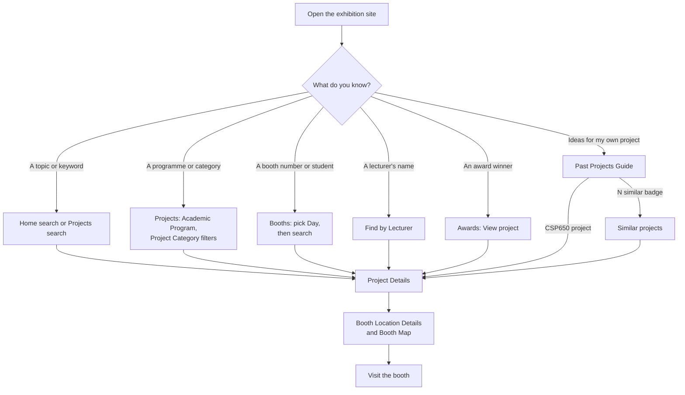

# Visiting the exhibition

## Who this is for

Anyone visiting the FSKM UiTM Jasin Final Year Project Exhibition: parents,
industry partners, lecturers and students, including juniors looking for
project ideas. You do not need an account. Everything in this guide works
without signing in.

The exhibition site is `fskmjasinfypexhibition.site`. It works on a phone,
tablet or computer.

!!! tip "On a phone"
    The site is designed for phones. Keep it open while you walk around the
    exhibition: the booth list and the map are one tap away.

## Finding your way around {#navigation}

=== "Desktop"

    The links run across the top: **Home**, **Projects**, **Booths**,
    **Schedule**, **Past Projects Guide**, **Announcements**, **Awards** and
    **Find by Lecturer**. In a narrower window some of these move into
    **More**, which also holds **Exhibition Info**, **FAQ**, **Past
    Exhibitions**, **Privacy Policy** and **Help** (this handbook). The
    **Feedback** button sits at the bottom right.

=== "Phone"

    There are five tabs at the bottom:

    | Tab | Opens |
    |---|---|
    | **Home** | The home page |
    | **Booths** | The booth finder |
    | **Guide** | The Past Projects Guide |
    | **Staff** | Find by Lecturer |
    | **Menu** | Everything else: **Project Catalogue**, **Schedule**, **Announcements**, **Award Winners**, **Exhibition Info**, **Frequently Asked Questions**, **Past Exhibitions**, **Privacy Policy**, **Help** and **Send Feedback** |

The **Sign In** button is for students and lecturers only. Visitors can
ignore it.

## 1. The home page {#home}

The home page shows the exhibition dates, hours and venue, with a
countdown before it opens (**LIVE NOW** while it is running). From here you
can:

- Type in **Search projects, supervisors or keywords** and press Enter to
  jump to matching projects.
- Click **Explore Projects** or **View Schedule**.
- See the number of **Projects**, **Programmes** and **Booths**.
- Browse **Featured projects** (**View All** for the full list) and **Award
  winners** (**All Winners**).
- Open the **Past Projects Guide** with **Open the Guide**.
- Under **Plan your visit**, use **Find a Booth**, **Exhibition Info** or
  **Open Map**.

The **FYP WORKSPACE** band with **Open FYP Workspace** is for CSP600 and
CSP650 students and lecturers (see the [Student guide](student.md)).

## 2. Browse and search projects {#projects}

[Open Projects :octicons-link-external-16:](https://fskmjasinfypexhibition.site/projects){ .md-button target=_blank rel=noopener }

1. Click **Projects** (on a phone: **Menu** → **Project Catalogue**).
2. Type in the search box (*Search by project title, student, or
   supervisor…*). The list updates as you type.
3. Narrow the list with the filters:
    - **Academic Program**, for example Computer Science or Cybersecurity.
    - **Project Category**.
    - **Show only** → **Industry Candidate**, for projects flagged as
      suitable for industry.
4. Click a project card to open its details.
5. If nothing matches you see **No Projects Found**. Click **Reset Filters**
   to start again.

## 3. Read a project's details {#project-details}

The **Project Details** page shows:

| Section | What it tells you |
|---|---|
| **Project Abstract & Description** | What the project does and why |
| **Key Technologies Used** | The tools and technologies |
| **Student Team** | The student or students, with **Matric ID** |
| **Project Supervisor** and **Examiner** | The lecturers responsible |
| **Booth Location Details** and **Booth Map** | Which booth to visit and where it is |
| **Links & Demos** | **GitHub Repository** and **Live Demo / Slides**, when the student added them |

Use the back arrow (**Back**) to return to the list, or **Back to
Catalogue** if the project was not found.

## 4. Find a booth {#booths}

[Open Booths :octicons-link-external-16:](https://fskmjasinfypexhibition.site/booths){ .md-button target=_blank rel=noopener }

1. Click **Booths** (on a phone, the **Booths** tab). The page is called
   **Find Exhibition Booths**.
2. Pick the **Day** first. Booths are grouped by presentation day and then
   venue.
3. Optionally pick a **Venue** and a **Program**. **Clear Venue & Program**
   removes both.
4. Search by booth number, project title or student name.
5. Click a booth to open its project.

## 5. Check the schedule {#schedule}

[Open Schedule :octicons-link-external-16:](https://fskmjasinfypexhibition.site/schedule){ .md-button target=_blank rel=noopener }

Click **Schedule** to see the **Event Schedule**. Each exhibition day has
its own tab. A slot marked **Ongoing** is happening now. Slots marked
**Internal** are for staff and students, not the public.

## 6. Awards and announcements {#awards}

[Open Awards :octicons-link-external-16:](https://fskmjasinfypexhibition.site/awards){ .md-button target=_blank rel=noopener }

- **Awards** shows the **Award Winners** with the team, programme,
  supervisor and sponsor. Click **View project** to open the winning
  project. Before the winners are announced the page says *Award winners
  have not been published yet. Check back soon!*
- **Announcements** lists the official updates from the FSKM organising
  committee, newest first.

## 7. The Past Projects Guide (for junior students) {#past-projects}

[Open Past Projects Guide :octicons-link-external-16:](https://fskmjasinfypexhibition.site/projects/junior-guide){ .md-button target=_blank rel=noopener }

The **Past Projects Guide** helps CSP600 students choose a topic. It lists
earlier CSP650 projects and CSP600 proposals, and shows which ones are
similar to each other, so you can avoid repeating a project and find
something new.

1. Click **Past Projects Guide** (on a phone, the **Guide** tab).
2. On the **Browse** tab, choose a **Section**: **All**, **CSP650** or
   **CSP600**.
3. Search by project title, supervisor or tech tags, and filter by
   **Academic Program**, **Project Category**, **Tech Stack**,
   **Supervisor**, **Session** or **Redundancy Status** (**Unique** or
   **Has Similar**).
4. Look at the **STATUS** of each project:
    - **Unique**: no close match found.
    - **N similar** with **High overlap**, **Medium overlap** or **Low
      overlap**: other projects share its technologies or title words.
5. Click the "similar" badge to open **Similar projects** for that project.
   Each match shows its **Shared categories** or **Shared title words**.
   Click **Back to the project guide** to return.
6. Open the **Redundancy Report** tab to see groups of projects that are
   **Similar by Tech Stack** (every project in the group has all the
   listed categories) or **Similar by Project Title**. A group marked
   **Cross-cohort overlap** means a junior proposal is close to a completed
   senior project.

!!! note
    CSP600 proposals have no detail page yet, so their rows do not open.
    Only CSP650 projects can be marked **Industry Candidate**.

## 8. Find projects by lecturer {#by-lecturer}

[Open Find by Lecturer :octicons-link-external-16:](https://fskmjasinfypexhibition.site/lecturer){ .md-button target=_blank rel=noopener }

**Find by Lecturer** (on a phone, the **Staff** tab) is for lecturers who
want to see the projects they supervise or examine, and for anyone looking
for a lecturer's projects.

1. Type the lecturer's full name.
2. Choose a **Role** (**Supervisor** or **Examiner**) and a **Day** if you
   want.
3. Click a project to open it. **Clear** starts again.

## 9. Past exhibitions {#archive}

**Past Exhibitions** (under **More**, or **Menu** on a phone) lists earlier
FSKM FYP exhibitions. Open one to see its **Projects** and **Award
winners**.

## 10. Exhibition info, FAQ and privacy {#info}

- **Exhibition Info** (**Exhibition Information**) explains the
  background, main objectives and competition categories, and shows the
  location with **Open in Maps** and **View event poster**.
- **FAQ** answers common questions, for example whether the exhibition is
  open to the public (yes, free of charge) and where to park.
- **Privacy Policy** explains what personal data is shown and how it is
  protected under the PDPA 2010. Only approved project information (which
  may include a matric number) is public; contact details, evaluations and
  login details never are.

## 11. Send feedback {#feedback}

- On a computer, click the **Feedback** button at the bottom right.
- On a phone, tap **Menu** → **Send Feedback**.

Fill in **Subject** and **Message**, optionally give a **Usability Rating
(optional)**, and click **Submit**. You see *Thank you for your feedback!*

## Tutorial: plan your exhibition visit {#plan-visit}

This takes about ten minutes, the day before you visit.

1. **Check the dates and place.** Open the home page and note the dates,
   hours and venue. Open **Exhibition Info** → **Open in Maps** to plan
   your route, and the **FAQ** for parking.
2. **Pick your projects.** Open **Projects**. Filter by the **Academic
   Program** you care about, or search for a topic such as "health" or
   "IoT". Open three to five projects that interest you.
3. **Note the booths.** On each project's details page, write down the
   booth from **Booth Location Details**, and check which day it is on.
4. **Check the schedule.** Open **Schedule**, choose the day you are
   visiting, and note any talks or the award ceremony you want to attend.
5. **Group by venue.** Open **Booths**, choose your **Day**, and pick a
   **Venue** to see which of your booths are close together.
6. **On the day**, keep the site open on your phone. Use the **Booths** tab
   to find each booth, and **Announcements** for last-minute changes.
7. **Afterwards**, see who won on **Awards**, and tell the organisers what
   you thought with **Send Feedback**.

## Troubleshooting

| Problem | What to do |
|---|---|
| **No Projects Found** | A filter or the search is too narrow. Click **Reset Filters**. |
| **No Booths Found** | Check the **Day**: booths are listed per day. Click **Clear Venue & Program**. |
| A project page says **Project Not Found** | The link may be old, or the project is not published yet. Click **Back to Catalogue** and search for it. |
| Projects or booths do not appear before the exhibition | Projects appear once the organisers publish them. Check back closer to the date. |
| *Award winners have not been published yet.* | Winners are announced during the exhibition. Check back later. |
| *No announcements available at this time.* | There are no updates yet. |
| I cannot see some links at the top on my laptop | They are under **More** when the window is narrow. Widen the window or use **More**. |
| A Past Projects Guide row does not open | It is a CSP600 proposal; only completed CSP650 projects have detail pages. |
| The page looks out of date | Reload the page. On a project list, use **Refresh projects**. |

## See also

- [Accounts and signing in](accounts.md), for students and lecturers
- [Student guide](student.md)
- [Lecturer guide](lecturer.md)
- [Handbook home](../index.md)
